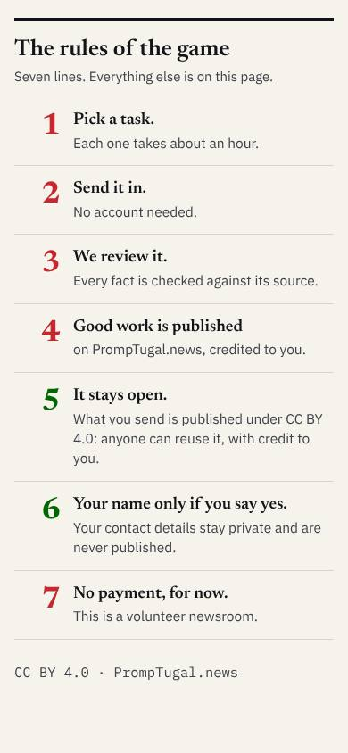

# /contribute/: the rules and the wall

## The rules of the game (the infographic)

**Built as HTML, not a picture**, so it is real text: readable at any size, read by screen readers and search, translatable with the page. Lift the fragment in `design/contribute/rules-fragment.txt (HTML, kept as .txt so the gate does not count it as a page)` (its `<style>` into the page's CSS; it uses the site's tokens, with brand v2.0 values as fallbacks) and place it after the opening, before "Where to start". Seven numbered rows, the number in Newsreader red, the head in Newsreader, the line under it in Plex; **rules 5 and 6** (it stays open; your name only if you say yes) **in green**, the brand's colour for a kept promise. One column on a phone, two from 900 px.

**The share picture:** `design/contribute/rules--share.png` (1200 x 630, the seven heads, the page's address, CC BY 4.0, the stamp) as the page's `og:image`.

## The wall

Pictures: `design/decisions/contribute/wall--{phone,desktop}.jpg` (placeholder contributors and counts: a name only with its owner's yes).

| Piece | Design |
|---|---|
| Intro | "The wall" in Newsreader; the journalist's line under it |
| The count | three tiles, **joined, submitted, published**, the number in Newsreader green, the label in small caps; live from the data, never typed |
| A card | a 56 px circle (the photo, location stripped, if given with consent; else the initial on ink); the name in Newsreader; "n pieces" in Plex Mono green; what they made in one line; the share buttons; one column on a phone, two from 760 px, three from 1100 px |
| No name | a contributor who said no to their name: "Name not shown", a pale circle with "?", no share buttons |
| Share | three outlined pills: "Share on LinkedIn", "X", "WhatsApp", plain links with the journalist's lines (no outside scripts: security@'s condition 5); each published contribution's page gets its own share picture later |
| Each contributor's page | the template line, then their pieces as the articles page's cards; CC BY 4.0 shown |

## The forms (the contribution, the beta list)

In the site's form style (the newsletter's, the search box's): labels above fields, 44 px fields, the consent box unticked by default with its words beside it ("Show my name with what I send"), the send button in brand green, and under it the journalist's privacy lines. No outside scripts.

## Check at v0.1.912 (22:40 UTC, 9 November)

Read live at 390 and 1440 px, light and dark.

| Piece | Result |
|---|---|
| The rules | **pass**: real text, one column on a phone and two on a desktop, numbers red, 5 and 6 green, the dark values (#f07278, #6dbb7e) in dark mode |
| A stray "into the page -->" above the rules | **fixed here**: it came from my fragment's comment (a tag name inside it); the comment now has no tags. My file, so fixed at the source |
| The wall | **pass**: the three tiles (1 joined, 0 submitted, 0 published), Andrew's card with an initial and "0 pieces published" |
| No outside scripts | **pass** (none loaded) |
| Consent boxes | **pass**: all unticked by default |
| **For dev@** | the page's `og:image` is still the site's general card; make it `design/contribute/rules--share.png` (or copy it under assets/contribute/), so a shared link shows the seven rules. Share pills on each card when a contribution is published |
