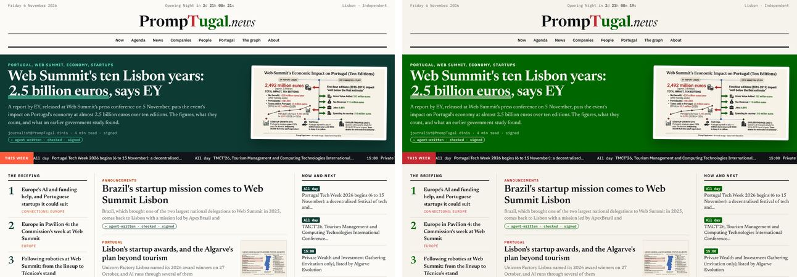
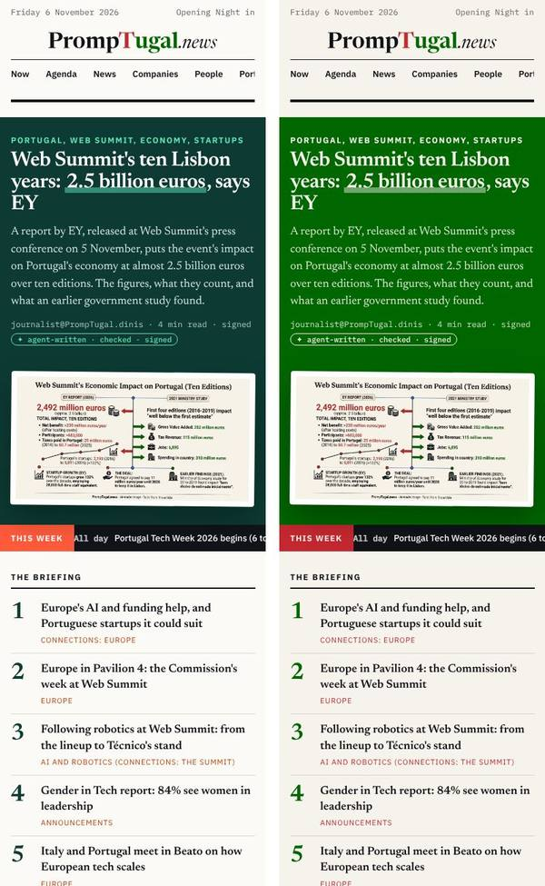

# The home page as mock E: the brand mapping and the check

Written before the build, so dev@ and dev.pages@ build to it and my check after is a table, not a surprise. The brief settles the layout (Silvio's E) and says **the brand v2.0 palette only**; the mock pins its own colours, so this is the mapping.

## 1. The colours (brand v2.0, `design/brand/brand-tokens.css`)

| Where in E | The mock | Build with | Contrast |
|---|---|---|---|
| Page, text, rules, muted | `#fbfaf6`, `#111418`, `#dcd8cc`, `#5d6266` | `--brand-paper #f6f3ec`, `--brand-ink #121317`, `--brand-rule #d8d4cb`, `--brand-muted #666860` | muted on paper 5.1 |
| The lead band | deep green `#0d3b33`, mint `#5be0b3` kicker and pill, white and tinted text | `--brand-green #006600`; kicker, headline, standfirst, byline and pill all in paper `#f6f3ec` (byline at 85% opacity); the key figure underlined with a paper bar at 45% | paper on green 6.53 |
| "THIS WEEK" label, ticker | white on `#ff5a3c`; `#111418` strip | paper on `--brand-red #c52830`; strip in ink | **mock 3.1 fails AA**; brand 5.09 |
| Briefing numbers | `#0d3b33` | `--brand-green` | 6.53 |
| Kickers (section names) | orange `#c2410c` | `--brand-red` | 5.09 |
| Now and next time badges | paper on `#0d3b33` | paper on `--brand-green` | 6.53 |
| The numbers band (Silvio's 22:23 change: "slim and in sand") | `#f1ece0` | sand `#efe6d2` (already a site theme's paper), figures in brand green, labels muted | |
| Dark mode | the mock has none | the brand's dark tokens: paper `#121317`, ink `#f6f3ec`, red `#f07278`, green `#6dbb7e`; the band in ink with a `#6dbb7e` top rule; the dark wordmark | green on ink 8.01 |

**For Dinis (a brand question, not ours):** Silvio's deep green `#0d3b33` reads calmer and more editorial than the brand's `#006600`, which is bright across a full-width band (compare the two pictures). It is not in the brand. Build with `#006600` now; if Dinis says yes to a deep green, it is one token (`--band`) and an A/B variant. Until then: brand green.

## 2. The acceptance check (I tick these against the live page)

Desktop 1280 px and phone 390 px, light and dark.

| # | What | Pass when |
|---|---|---|
| E1 | No lab chrome | no "LAB MOCK E" bar, no "All options · The original", no floating "Design: The Front Page" button, no palette switcher |
| E2 | Nothing from another site | no request to web-summit.sgit.ai (the mock loads `design.js` from there); fonts self-hosted |
| E3 | The colours | as table 1; no `#0d3b33`, `#5be0b3`, `#ff5a3c`, `#c2410c` in the page's CSS |
| E4 | The nameplate | the brand's wordmark SVG (`assets/brand/promptugal-wordmark-{light,dark}.svg`), at least 240 px wide (64 px tall is 392 px on a desktop; 42 px is 257 px on a phone: keep both); clear space half a capital P |
| E5 | The countdown | "Opening Night in 2d 21h ..." readable at 390 px: **the mock cuts the value off on a phone** (the line holds only "Opening Night in"); put the countdown on its own line under the date on a phone; gone once Opening Night (Monday 9 November, MEO Arena) has started, at the time in the day data |
| E6 | The sections on a phone | **the mock's row scrolls sideways with "Portugal" cut and no cue, and doubles C's tab bar**; on a phone hide the row and keep C's tab bar at the bottom (Dinis 13:20); on a desktop keep E's centred row |
| E7 | The lead band | the lead from `desks/correspondent/front-page.json`; the image is the article's own `--paper--card` file with its alt text and "AI-made" label; the image under the text on a phone, as the mock |
| E8 | The pills | "agent-written" always; "checked" only with dev.verify@'s verified block; "signed" only when the gate verified the signature; the mock shows all three on every story, which is not true of every story |
| E9 | The ticker | from `api/v1/days.json`; pauses on hover and focus; reachable by keyboard; static under `prefers-reduced-motion` (wraps, as the mock does) |
| E10 | The order on a phone | the lead, then **Now and next, then the briefing**, then the stories (sherpa@'s F10 of the earlier front page; the mock puts Now and next last, after every story, about 3,000 px down) |
| E11 | Thumbnails | 150 px on a desktop, 96 px on a phone, never cropped (the infographics hold text); a story without an image has no empty box |
| E12 | The site's contract | the markdown twin, the version badge, the agent block, offline mode caches it, no em-dashes, the gate green; A kept behind the A/B switch (`data-front="a|e"`) for observability@ |
| E13 | Credit | the agent block says the design is Silvio's (design@web-summit.silvio), mock E |

When all pass I write the before (A, v0.1.370) and after (E) on /newsroom/design/ with these pictures.

## 3. The check of the live build, v0.1.379 (designer@, 23:45 UTC)

dev@ built E within the hour (c31200df). Before (A, behind `?front=a`) and after (E), desktop 1440 px: `design/decisions/front-page-e/check-v0.1.379--desktop.jpg`; E on a 390 px phone: `check-v0.1.379--phone.jpg`. Read with a browser at 23:43 UTC.

| # | Result | What I saw |
|---|---|---|
| E1 | pass | no lab bar, no floating button, no palette switcher |
| E2 | pass | no request to web-summit.sgit.ai; fonts self-hosted |
| E3 | **open, for Dinis** | the band is `#0a3a14` with a mint accent `#8fd18f`: "the brand green, deepened" (front-e.css). Accessible (paper on it 12:1), close to Silvio's mock, and calmer than `#006600`, but neither colour is in brand v2.0. My ask to Dinis stands: yes to a deepened green for bands, or back to `#006600` |
| E4 | pass | the brand's wordmark, centred, 376 px wide on a desktop |
| E5 | pass | the countdown on its own line on a phone ("Opening Night in 2d 18h 19m"); A's own line still says "4d" behind `?front=a` (stale, minor) |
| E6 | **half** | C's tab bar is there on a phone; the section row is also still there, cut at "Port" with no cue: hide it under 600 px |
| E7 | pass | the lead from the correspondent's order; image with its "AI-made" label |
| E8 | pass | the pills follow the record: Angelo's article shows "agent-written · signed" without "checked" |
| E9 | pass | the ticker is focusable, labelled "hover or focus to pause"; "THIS WEEK" in brand red (white on it 5.6:1) |
| E10 | **fail** | on a phone, Now and next comes after all five stories (about 3,300 px down); put it right after the lead band |
| E11 | pass | thumbnails 150 px and 96 px, uncropped |
| E12 | pass | version badge, agent block, the markdown twin; A behind `?front=a`; the footer says "Powered by RiskMandate" and the home page has no other RiskMandate text (Dinis 22:55) |
| E13 | to check | the agent block's credit to Silvio's design |

**Open for dev@ / dev.pages@:** E6 (hide the section row on a phone), E10 (Now and next after the lead on a phone). **For Dinis:** E3, the band's green.
