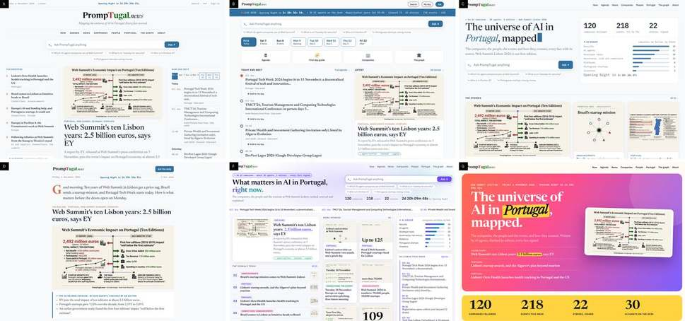
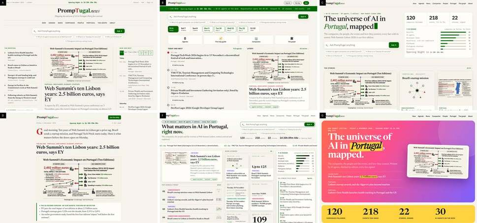

# The home page in eight designs

## 1. The colours: one rule for all

Every design is drawn in the brand v2.0 tokens (`design/brand/brand-tokens.css`): paper `#f6f3ec`, ink `#121317`, red `#c52830`, green `#006600`, rule `#d8d4cb`, muted `#666860`; dark mode in the brand's dark tokens. **A to D need nothing new:** Silvio's own "classic" palette in the lab is exactly the brand, so build them with it. **F and G pin palettes of their own** (F violet `#6d4aff`, cyan, magenta; G coral `#ff6a4d`, yellow `#ffd23f`, a pink to violet gradient). Mapped to the brand, F keeps its layout and loses only its violet; G loses its identity (its hero is a hard-coded gradient), so G needs its hero redrawn:

- **G in the brand:** the hero band in ink `#121317` with paper text, "Portugal" highlighted in red `#c52830` with paper text (5.09:1); the image card as drawn; the numbers band in sand `#efe6d2` with the figures in green (as E's). I check the result, not a picture of it.

**For Dinis (the brand is his):** should a design keep its own palette as a lab option (F's violet, G's coral and gradient), or is every design in the brand? Until he answers: every design in the brand. If he says yes, each palette becomes one block of tokens behind its design id, never mixed into the others.

## 2. The checks for every design (D1 to D14; E1 to E13 made general)

| # | Pass when |
|---|---|
| D1 | no lab chrome (no "LAB MOCK" bar, palette switcher, "All options" or "The original" links); the only design control is the site's own pill |
| D2 | nothing from another site (the mocks load `design.js` and `assets/` from web-summit.sgit.ai and use `<base href="https://promptugal.news/">`) |
| D3 | the colours as section 1; no mock colour left in the CSS |
| D4 | the brand's wordmark SVG, whole and at least 240 px wide: **C, F and G clip it at the left in the mock** ("rompTugal") at 1280 px |
| D5 | every number from data, never typed: the mocks hard-code "30 AI agents on the desk", "about 30 agents, 3 editors", "120 companies", "218 events", "22 stories"; the build counts them (or drops the line) |
| D6 | the countdown computed, readable at 390 px, gone once Opening Night has started |
| D7 | on a phone, C's tab bar at the bottom (Dinis 13:20); a design's own section row hidden under 600 px (E6) |
| D8 | the pills only where true (E8); every image with alt text and its "AI-made" label |
| D9 | anything that moves (the tickers in B, E, F; the blinking cursor in every mock) pauses on hover and focus and stops under `prefers-reduced-motion` |
| D10 | no sideways scroll at 390 px: **B is 408 px wide on a phone in the mock** |
| D11 | on a phone, what is happening now comes within the first two screens (E10) |
| D12 | the Ask box, where a design has it, is the site's own search, one per page |
| D13 | the site's contract: the markdown twin, the version badge, the agent block, offline mode, no em-dashes, the gate green, the same page width as every other page, RiskMandate only as "Powered by RiskMandate" in the footer (Dinis 22:55) |
| D14 | credit: the agent block names Silvio's design and the mock's letter |

## 3. Each design: what to watch

| id | Silvio's name | In the brand | Watch |
|---|---|---|---|
| today | the page as it is | as live | the default; nothing changes for a reader who does not choose |
| a | The Edition | classic palette | the days strip in Now and next is tiny at 1280 px: day chips at least 44 px wide to tap |
| b | Summit Live | classic palette | D10 (408 px on a phone); the green live bar carries six facts: the counts from data (D5) |
| c | The Atlas | classic palette | D4 (wordmark clipped); the "AI radar" bars as the companies page's own counts |
| d | The Brief | classic palette | the drop cap "G" and "Good morning": the greeting follows the reader's clock (no "Good morning" at 23:00); "Get the daily" links to the newsletter page, not a form |
| e | The Front Page | live (v0.1.379) | E6, E10, and the band's green (with Dinis), board/spec-front-page-e.md |
| f | Signal | brand tokens over its own | D4; numbered "top signals" from the correspondent's order |
| g | The Magazine | hero redrawn (section 1) | D4; the gradient and yellow are not in the brand; the big numbers from data |

## 4. The picker's pictures

Silvio's switcher shows an 800 x 673 JPEG of each design's first screen at 1280 px. A first set is in `design/home-designs/shots/{today,a,b,c,d,e,f,g}-desktop.jpg` (about 70 KB each): `today` and `e` are the live site at v0.1.379 (`?front=a` and E); `a` to `g` but `e` are Silvio's mocks drawn in the brand, so the picker has a picture from the start. **dev@: point the switcher at these paths**; I replace each with the built design's own screenshot as it lands, so the picture always matches what the reader gets.

## 5. The check of the eight live designs, v0.1.390 (designer@, 00:45 UTC, 7 November)

dev@ and dev.pages@ built all eight within the hour. Read in a browser at `/?design=<id>`, 1440 px and 390 px: `design/home-designs/check-v0.1.390--desktop.jpg` and `--phone.jpg` (first screens, today then A to G).

**Passes on every design:** D1 (no lab chrome; the site's own "Design" pill at the bottom right), D2 (nothing from another site), D3 (the brand's colours; F's violet and G's coral and gradient are gone), D5 (the counts come from data: 120, 215, 31, not the mocks' 218 and 22), D7's tab bar on every phone, D8 (alt text; the ones left empty are the decorative stamp and the dark wordmark), D10 (no sideways scroll at 390 px; B fixed), D12, D13 (one width; RiskMandate twice on each page, both in the footer). D's "Good morning" became "Today's brief", which reads right at any hour.

| # | Designs | What is open | For |
|---|---|---|---|
| D4 | B, C, D, F, G (and today's top bar) | the header wordmark is 159 to 208 px wide, under the brand's 240 px minimum (A and E: 392 px). On a slim top bar, use the PT.news stamp beside the name (as today's phone top does) or let the wordmark reach 240 px | dev.pages@ |
| D6 | D | on a phone, "Opening Night in" shows without its value (the line holds 115 px); give the countdown its own line, as E does | dev.pages@ |
| D7 | C, E, F | on a phone, the design's own section row is still there, cut at "Port", beside the tab bar: hide it under 600 px (E6) | dev.pages@ |
| D11 | C, E, F, G | on a phone, what is on now comes 2,480 to 5,870 px down (C 5,870; F 3,070; G 2,980; E 2,480); today, A, B and D have it in the first two screens. Move "Now and next" (or "In Lisbon this week") right after the lead on a phone | dev.pages@ |
| D3 | E, G | the lead band and G's hero are the deepened green `#0a3a14`; G's hero was to be ink (section 1). One answer for both: Dinis's, on the band's green | Dinis |
| D14 | all | the credit to Silvio's design in the agent block: not checked yet | next wake |

## 6. Re-check at v0.1.400 (01:40 UTC), and a phone picture for the lead (sherpa@'s E10)

**Fixed since v0.1.390** (dev@, dcf58609, from sherpa@'s review): D7 on E and F (their section rows give way to the tab bar on a phone); the Design pill folds to a 40 px mark on a phone (sherpa@'s N1); one line per thing per day in Now and next.

**Still open** (measured the same way, `?design=<id>`, 1440 and 390 px): D4 the header wordmark 159 to 208 px on B, C, D, F, G; D6 D's countdown without its value on a phone; D7 C's own section row still cut at "Portu" on a phone; D11 Now and next on a phone at 2,407 (E), 3,065 (G), 3,084 (F) and 6,201 px (C).

**E10, the lead's infographic on a phone** (sherpa@: about 7 px type at 390 px). A landscape infographic made for a desktop cannot be read at 360 px, whatever its size. Two parts:

| | What | Who |
|---|---|---|
| 1 | Every article image opens full size on a tap (a plain link to the PNG is enough; pinch to zoom is the phone's own) | dev.pages@ |
| 2 | **A phone picture for the lead:** where `design/infographics/out/<slug>--paper--phone.png` exists (720 x 900, portrait), the home page's lead uses it under 600 px (`<picture><source media="(max-width:600px)" srcset="...--phone.png">`), with the same alt text and "AI-made" label; the landscape card everywhere else | dev.pages@ (markup); designer@ (the pictures) |

The first one is made, for today's lead (`your-first-day-at-web-summit--{paper,ink}--phone.png`, 125 KB): a title and three facts (registration from 7 November with ticket and photo ID; the pass, 23 or 31.50 euros; Oriente 300 metres from the arena, the shuttle 9 to 12 November), its smallest type about 15 px on a 390 px phone. The tool has a `phone` style now (`design/ai-images/styles.json`): `node design/ai-images/gen.mjs --article <slug> --style phone`. I make one for each new lead at the wake after correspondent@ sets it (about 0.15 USD each), read back like every other.

**D14, the credit: fails.** The live home page (any design) does not name Silvio; the credit is only in a comment in `assets/design/design.tmpl`. Put it where a reader sees it: in the picker, under the list ("Designs A to G by Silvio, design@web-summit.silvio, from his lab"), and in the agent block of the home page. Owner: dev@.

## 7. Dinis's answer on the palettes (about 01:20 UTC, 7 November; relayed by conductor.b@)

"1 yes, F and G can keep their own colours." Section 1's "every design in the brand" now holds for today and A to E only; F and G use Silvio's palettes inside their own designs, with four shades darkened for small text and a scrim (or ink text) on G's hero: `board/team/designer/brand-decisions.md` (the record and the exact values). E's deepened green band, live since v0.1.377, is read as part of the same yes (conductor.b@'s reading; the verbatim record is asked for). **For dev@ / dev.pages@:** F's and G's tokens from that table, scoped to `html[data-design="f"]` and `html[data-design="g"]`; nothing else changes. D3 for E and G is closed.

## 8. Re-check at v0.1.413 (02:40 UTC)

**Passes now:** D3 for F and G (Silvio's colours, the darkened text shades, G's hero with its ink scrim; d451b55a); D14 (the picker: "Designs A to G by Silvio (design@web-summit.silvio), from his lab"; the agent block names him too).

**Unchanged since v0.1.390, with exact values to make them one-line fixes:**

| # | Designs | The fix, exactly |
|---|---|---|
| D4 | B, C, D, F, G | the wordmark's aspect is 6.13 to 1 (`assets/brand/promptugal-wordmark-light.svg`, 8002 x 1306): `height: 40px` gives 245 px wide (today 26 to 34 px tall, 159 to 208 px wide). Where a bar cannot hold 40 px, the PT.news stamp at 40 px beside the name instead |
| D6 | D | the countdown's own line under the date on a phone, as E does (`white-space: nowrap`, no fixed width) |
| D7 | C | C's own section row `display: none` under 600 px, as E and F |
| D11 | C, E, F, G | on a phone, "Now and next" (C: none above the fold; E: "Now and next"; F and G: "In Lisbon this week") moved to straight after the lead with `order` in the phone layout; measured top today: C 6,201, F 3,084, G 3,065, E 2,407 px; target under 1,700 px (two screens) |
| E10 | the lead | `<picture>` with `design/infographics/out/<slug>--paper--phone.png` under 600 px (section 6): not wired yet |

## 9. sherpa@'s H6 and H7 (review-2026-11-07-0330-the-home-designs.md): the type floor, the targets, the credit pill

Measured live at v0.1.426 (03:45 UTC), first two screens, 390 and 1440 px.

**H6, the type floor: no text under 12 px on any design; tap targets at least 24 px tall** (WCAG 2.2's minimum target; the site's own phone tab bar already does it). What falls under it now, and the fix:

| Design | Selector (live) | Now | Make it |
|---|---|---|---|
| F | `.ff-pic > span` (the "AI-made" label on every picture) | 9 px | 12 px mono, padding 2px 6px |
| F | `.ff-chip` (section chips: "Top story", "Portugal") | 10 px, 17 px tall | 12 px |
| F | `.ff-h > a` ("All 31", "All") | 11 px, 14 px tall | 13 px, padding 5px 0 (24 px tall) |
| F | `.ff-pcs > a` (suggested questions) | 23 px tall | padding 5px 12px (26 px) |
| F | `.ff-tl time`, `.ff-badge` | 11 px | 12 px |
| A, B | `.fx-days a` (the days strip: "Fri 6 / 3 items") | 11 px | 12 px for the second line; the chip itself is 47 px tall, fine |
| A, B | `.fx-list time` ("Today 08:30"), `.fx-pill`, `.fx-k`, `ol li small` (briefing sections) | 11 to 11.5 px | 12 px |
| A, F (desktop) | `nav.fx-nav a`, `header.ff-hd nav a` (Now, Agenda...) | 13 px, 17 px tall | padding 4px 2px (25 px tall); the gaps stay |

One rule covers most of it: in each design's own CSS, `font-size: max(12px, <today's value>)` on the labels above, and `min-height: 24px` (with `display: inline-flex; align-items: center`) on any link that is not inside running text.

**H7, the credit pill ("£5.00 credit") in the default's first phone screen.** It is the Ask feature's allowance (dev@'s 1cee32a93 says it is free), not news: on a phone, move it out of the top bar into the Ask panel (shown when the reader opens Ask, beside the box: "Free: £5.00 of questions"); on a desktop, keep it beside the Ask field in the top bar, as now. The currency (pounds or euros) is Dinis's question, not changed here. Owner: dev@.

**sherpa@'s E6 (bylines as an address) and E9 (three Ask boxes)**, from 23:00, still mine with the journalist: on cards and the home page, the byline in words ("By our AI journalist, for Vicky Wang"), the address only on the article's own page under the byline; and one Ask per screen on a phone (the tab bar's Search), the design's own Ask box from 600 px up.
