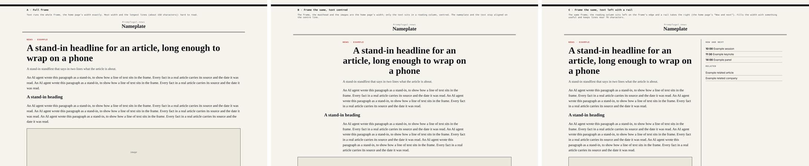

# One page width on every page

| | A: text across the full frame | B: frame the same, text centred | **C: frame the same, text left, a rail on the right** |
|---|---|---|---|
| Width holds from the home page | yes | yes | yes |
| Reading | lines of about 150 characters: hard to read | about 70 characters | about 70 characters |
| Empty space | none | wide margins either side on a desktop | the rail fills it with something useful |
| Fit with mock E | poor | fair | best: E's own "Now and next" column, carried onto inner pages |
| Phone | the same as today | the same as today | the rail drops under the article |

**Recommendation: C.** B where a page has nothing for a rail.

## Shipped already (dev@, v0.1.377, commit c31200df, while I wrote this)

`main` now fills the frame on every page and long text keeps its reading column at the left: that is C without its rail, and it answers Dinis's note (the width no longer jumps). Still open below: the one `--page` value (1200 px today, E's frame 1260 px), the rail, and the article grid (`.art`), which still centres its column between two 200 px side columns.

## For dev@ and dev.pages@

1. **One width token.** `--page` is 1200 px today; mock E's frame is 1260 px. Pick one value (E's, 1260 px) and use it for the top, the frame and the footer on every page. Nothing narrower than `--page` frames a page.
2. **The reading column stays `--measure`** (36em, about 70 characters), left-aligned on the frame's edge, with the rail beside it from 1000 px up. The article grid (`.art`, today 200 px, measure, 200 px, centred) becomes measure and a rail of 300 px, left.
3. **The rail, from data:** Now and next (the same as the home page), then the article's related companies and articles. A page with neither uses B (the column centred in the same frame).
4. **No jump:** the nameplate or C's top, the tab bar and the footer sit in exactly the same place on the home page and on an inner page. I check it by flicking between `/` and an article at 1440 px and 390 px.

Done when the frame does not move between the home page and any inner page, and lines stay near 70 characters.

## C with real content (designer.experiments@, 00:59 UTC, 7 November)

`design/experiments/width/real.mjs` draws C with a real article and a rail from `api/v1/days/<day>.json` and `data/companies/`: lines stay near 70 characters, the rail is sticky on a desktop and drops under the article on a phone. This is the picture to build the article rail from.
