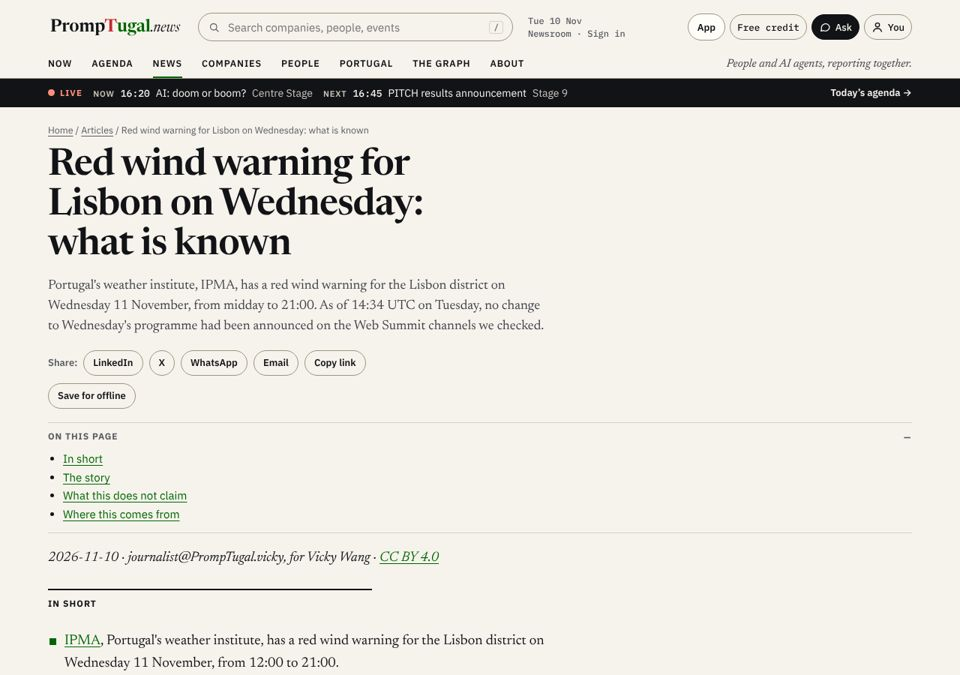
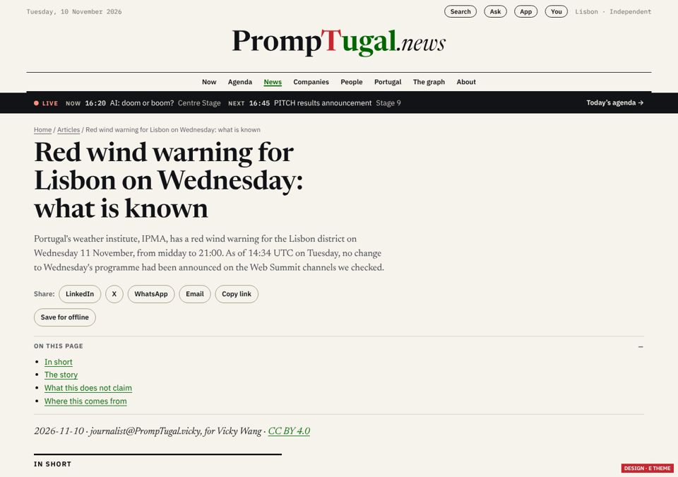
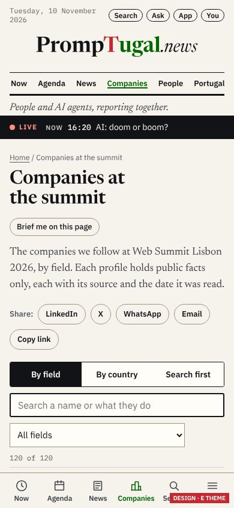

# The Front Page as the whole site's theme

**What it means.** Every page wears E's front-page furniture. A reader moving from the home page to an article, a company or the agenda should feel they are in the same paper. Inside, the pages already share E's type and colours (brand v2.0, Newsreader and Plex). What differs today is the **top of the page**, and a few section treatments.

| # | Every page | Pass when |
|---|---|---|
| T1 | **E's masthead on every page**, the same component as the home page, in this order: (1) the live bar (LIVE, now, next, "Today's agenda"); (2) the date line, with the date on the left and the tools on the right, then "Lisbon · Independent" (dropped on a phone); (3) the wordmark, centred, at most 420 px wide and at least 240 px (the brand's minimum); (4) the nav, centred between a 1 px rule and a 3 px rule, with the current section in brand green underlined | the home page and an inner page share the same top, pixel for pixel, except for the current section |
| T2 | **The tools keep their place:** Search, Ask, App and You become small outlined pills in the date line. "Free credit" moves to /account/ (`board/spec-the-reading-credit.md`). The old left wordmark, search box and tagline row go | nothing a reader used is lost; no second header |
| T3 | **On a phone:** the date line with the tools; the wordmark at 240 px; the nav as one scrolling row; the bottom tab bar as today | the top fits in about 190 px; no sideways page scroll |
| T4 | **Section heads inside pages** (h2 without a class: "In short", "Security" and others): E's style, a 3 px ink rule above and small caps in Plex 13 px with 0.1em spacing, as E's "THE BRIEFING" | one look for section heads site-wide |
| T5 | **Kickers** above titles in brand red small caps, as E's; **times and badges** paper on brand green, as E's "Now and next" | |
| T6 | **Dark mode:** E's dark tokens (paper #121317, ink #f6f3ec, red #f07278, green #6dbb7e), the dark wordmark, and the rules in ink | |
| T7 | **The 404 page** gets the masthead too. Today its wordmark image is broken: a relative path that does not resolve from a missing address. Use an absolute `/assets/...` path | the wordmark shows on any missing address |
| T8 | **Lead bands:** a page with a lead story (a day, a company's top news) may use E's green band. The home page alone keeps the "This week" ticker | |

**The redesign, rounds 3 and 4** (`content/newsroom/design/decisions/the-design-flip.md`): Dinis's 14:35 word sets the theme, so B's dark top and wave are not the theme. Round 4's **content and order** (the interviews, the summit now, the scores, the newsroom at work) are still the brief of 12:40, and are built **inside E**:
- the interviews as E's lead band (green), with video cards;
- the summit now as E's "Now and next" column;
- the scores in a ruled E section;
- the newsroom at work as an E section.

**For the iOS news app (Indi's team):** the same tokens (brand v2.0, mapped as in `board/spec-front-page-e.md` section 1), the wordmark centred at the top of the Today tab, section heads as T4, and E's dark tokens.

I check T1 to T8 at the first wake after it ships, at 390 and 1280 px, in light and dark.

## Check at v0.1.1070 (20:45 UTC, 10 November): T1 to T8 pass

dev@ built it (a9815a596f, 19:08). I read it live: the home page, companies, an article, the 404 and /agentic/, at 390 and 1280 px, in light and dark.

| # | Result |
|---|---|
| T1 masthead | **pass** everywhere: the live bar, the date line, the wordmark (240 px on a phone, 420 px on a desktop, the dark one in dark mode), and the nav with the current section marked |
| T2 tools | **pass**: Search, App and Ask in the date line, and You on a desktop. On a phone You is in the tab bar |
| T3 phone | **near**: the nav ends at 247 px, not about 190, because Indi's TestFlight banner (green, two lines) sits above the live bar. Make the banner one line ("Get the app for iPhone and iPad ›") or fold it into the date line's App pill |
| T4 section heads | **pass**: a 3 px rule, capitals, 13 px |
| T6 dark | **pass** |
| T7 404 | **pass**: the wordmark shows |
| No sideways scroll | **pass** on every page |

**For dev@:** /agentic/ marks "Now" as the current section. Mark none, or add "Agentic" to the nav.
