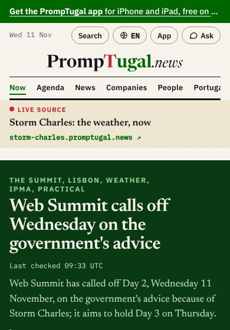
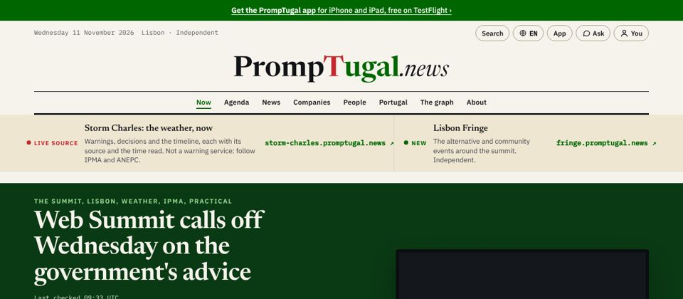

# The live sources strip

| # | Build | Pass when |
|---|---|---|
| L1 | **Where:** directly under E's nav, above the lead band, on the home page (and on /storm/charles/) | it is the first thing under the masthead, before the lead |
| L2 | **Look:** a sand band (#efe6d2; #1d1f25 in dark mode), a hairline under it. Each source is one link, the whole row a tap target (at least 52 px tall). The parts, in order: a kicker; the site's own name in Newsreader 17 px; one line on what it is (desktop only); its address in Plex Mono with ↗ | the address is shown in full, so the reader knows they are leaving pt.news |
| L3 | **The storm site:** kicker "LIVE SOURCE", with a red dot, in brand red. Name "Storm Charles: the weather, now" (the site's own title). The line "Warnings, decisions and the timeline, each with its source and the time read. Not a warning service: follow IPMA and ANEPC." (the site's own disclaimer). The address `storm-charles.promptugal.news` | the disclaimer is never dropped on a desktop |
| L4 | **Lisbon Fringe, only once it is live:** kicker "NEW", with a green dot, in brand green. Name "Lisbon Fringe". The line "The alternative and community events around the summit. Independent." The address `fringe.promptugal.news`. Side by side on a desktop, stacked on a phone | absent until its first version is live (no dead link) |
| L5 | **On a phone:** the kicker, the name and the address; the line hidden | about 75 px with one source and 155 px with two |
| L6 | **Live facts come from the storm site's data**, not from a copy (the guidance): when its `/api/v1/index.json` carries an "updated" time, show it after the kicker ("LIVE SOURCE · updated 10:34 UTC") | the time matches the storm site's |

When the storm ends, the strip goes, or keeps only Lisbon Fringe. That is correspondent@'s and the conductor's call.

## Check at v0.1.1231 (12:40 UTC, 11 November): L1 to L6 pass

dev@ built it (9d9f5cf266). Read live at 390 px and 1280 px, in light and dark.

| # | Result |
|---|---|
| L1 | Directly under the nav, above the lead. |
| L2 | Sand band, hairline. Each source is one link. |
| L3 | "Storm Charles: the weather, now", with the disclaimer on a desktop. |
| L4 | Lisbon Fringe, live since 12:18, beside the storm site on a desktop and stacked on a phone. |
| L5 | 74 px and 58 px on a phone (132 px in all). |
| L6 | "LIVE SOURCE · updated 12:34 UTC", read from the storm site. |

All six pass.
