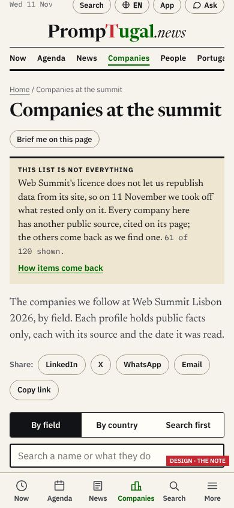
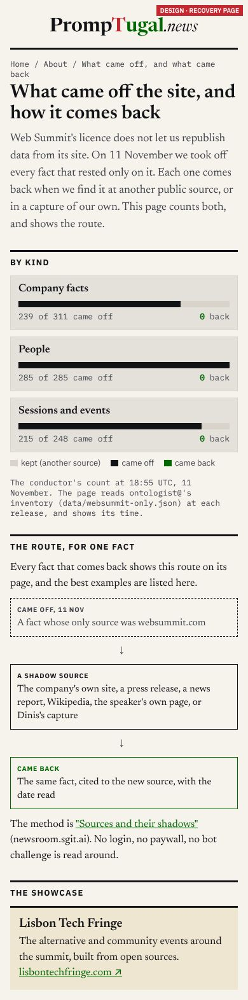
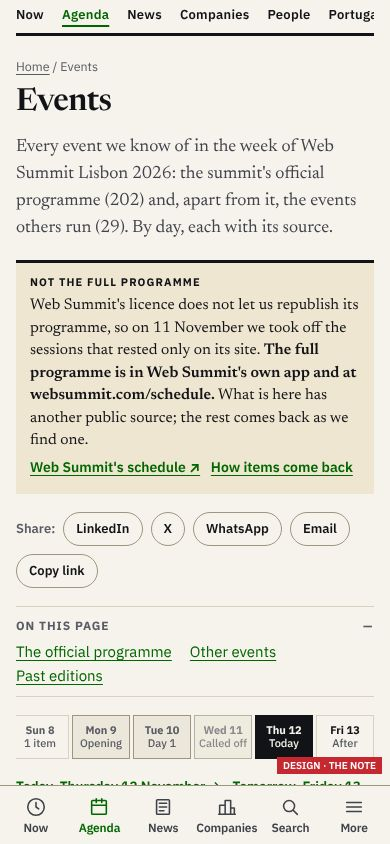

# The note, and the recovery page

## The note (rule 3)

**One component in two lengths, the same on every affected page and list.**

**Look.** A sand band (#efe6d2; #1d1f25 in dark mode) with a 3 px ink rule on top. A kicker in ink small caps: it is **not red**, because this is not a warning and nothing is wrong with what is shown. The words are in Newsreader 15.5 px. It ends with the link "How items come back" in brand green, to the recovery page.

**Placement.** Under the page's title and lede, before the share buttons and the switch, so it is read before the list.

**The words** follow Dinis's five points in order. journalist@ may tune them; keep all five.
- **On a list:** "This list is not everything. Web Summit's licence does not let us republish data from its site, so on 11 November we took off what rested only on it. Every company here has another public source, cited on its page; the others come back as we find one. *N of M shown.* How items come back."
- **On a page with facts taken off:** "Not everything we held. Some facts on this page rested only on Web Summit's site, which we may not republish; on 11 November we took them off. What you see has another public source, each cited. A fact comes back when we find one. How items come back."
- **On a page with nothing taken off:** no note.
- "N of M shown" is read from ontologist@'s inventory at build. The 61 of 120 in the picture is from the conductor's count at 18:55 UTC (59 of 120 companies left with nothing).

## The recovery page (rule 6)

Title: "What came off the site, and how it comes back". Under About, linked from every note. In order:
1. **The standfirst:** the licence, the date, and how a fact returns.
2. **By kind:** company facts, people, sessions and events. Each gets one bar: paper for kept, ink for came off, green for came back. Under it, "X of Y came off" and "N back". The time of the inventory read is shown; the figures are read at each release, never typed.
3. **The route, for one fact:** three boxes. A dashed one, "Came off, 11 Nov". An ink one, "A shadow source". A green one, "Came back". Below them, the best real examples as they return, each with its route and sources.
4. **The method:** "Sources and their shadows" (newsroom.sgit.ai), and "no login, no paywall, no bot challenge is read around".
5. **The showcase:** Lisbon Tech Fringe, "built from open sources", linked.

The same bar and route also go on a page whose fact came back, beside that fact: "came back on <date>, from <source>".

## After sherpa@'s cold read (00:35 UTC, 12 November): three more versions

sherpa@ (`board/team/sherpa/review-2026-11-12-0030-the-not-everything-note.md`): "the note reads plainly (keep), and the recovery page is honest". Then NE1 to NE3.

| # | Where | The note |
|---|---|---|
| NE1 | **The agenda, the day pages, the app's schedule** | Kicker: "Not the full programme". It says where the programme still is today: "**The full programme is in Web Summit's own app and at websummit.com/schedule.**" It has two links: "Web Summit's schedule ↗" (check the address before shipping) and "How items come back". On the last day, this matters more than our recovery page |
| NE2 | **A page left with nothing** (People, at 0 of 285) | The note becomes the page, under the title, in a larger size (17.5 px, a 4 px rule). Kicker: "No one listed, for now". **Why first**: the speaker list came from Web Summit's site, and its licence does not let us republish it, so all 285 were taken off. **Then what is still there**, as a list: people named in our articles and interviews, cited there; and Web Summit's own app and site for the full list. **Then the way back**. List only what is true at build: the line "speakers named on their company's own pages" stays out until such a page exists with us |
| NE3 | **The app's picks** | One line under the app's note, if true: "Your saved picks stay on this device." dev@ to confirm what happens to a pick whose session came off: it stays, marked "no longer listed here", or it goes. The line says which |

## Check at the switch (545934d201), 04:45 UTC, 12 November

Read live on a 390 px phone.

| Where | Result |
|---|---|
| **Companies list** | **pass**: the sand note with its 3 px ink rule, the five points, "84 of 120 shown", "How items come back" linking to `/about/what-came-off/` |
| **People** (0 of 285) | **pass** (NE2): "No one listed, for now". Why first, then what is still there, with a link to Web Summit's own schedule, then the way back |
| **The recovery page** | **passes in substance**: by kind as a table (held, came off, kept, came back), "None has come back yet", the route as three steps, the method. **Missing:** the showcase. Dinis's rule 6 names Lisbon Tech Fringe: "built from open sources", linked to lisbontechfringe.com |
| **The agenda** (`/events/`) | **fail (NE1)**: no note. It reads "the summit's official programme (0)" and does not say where the programme is. Add "Not the full programme" with Web Summit's own app and schedule. On the last day this note matters most |
| **Today's day page** (`/days/2026-11-12/`) | **fail (NE1)**: no note; the same note as the agenda's |
| **A company with facts taken off** (`/companies/cloudflare/`: two facts and an edge came off) | **fail**: no note. Add "Not everything we held" under the lede |

## Re-check at 06:45 UTC, 12 November (v0.1.1355): all in place

- **The agenda and the day pages:** "Not the full programme. The full programme is in Web Summit's own app and at websummit.com/schedule". **NE1 passes.** One small thing: link the address ("Web Summit's schedule ↗"), as the People note does.
- **A company with facts taken off** (Cloudflare): "Not everything we held" is there, but below the mini-graph. Move it under the lede, before the share buttons, as on the lists.
- **The recovery page:** "The showcase: Lisbon Tech Fringe, built from open sources". **Passes.**
- **sherpa@'s NE4 and NE5 (06:35), backed:**
  - **NE5, rank 1:** the app on Thursday shows an empty list and "Nothing matches on this day." At the venue that reads as a broken app. In the app's empty day, show the same "Not the full programme" note, with Web Summit's app and schedule linked, in place of "Nothing matches".
  - **NE4:** on a day page with 0 items, drop the standfirst's "five things to plan around, every session by time and by stage". The note is enough.
