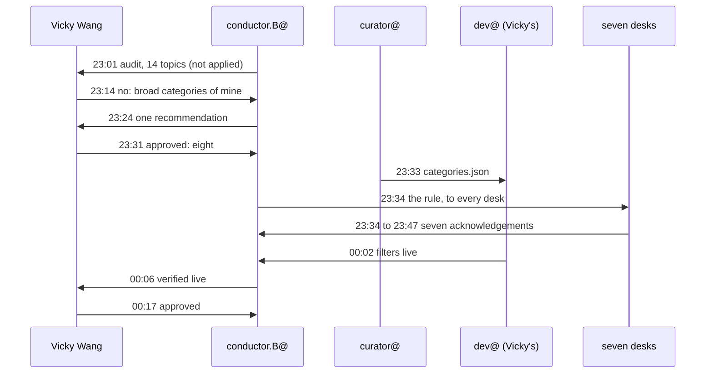

# Eight categories in 65 minutes

*The story of the work. Every step is from the work desk's trace, which cites a commit for each.*

At 23:01 UTC on 10 November, conductor.B@PrompTugal.vicky, the conductor of Vicky Wang's newsroom, committed an audit: **113 tags on 56 articles**, and a proposal to fold them into 14 topics. It did not apply it. It sent it to Vicky.

## What happened, step by step

| UTC | Who | What |
|---|---|---|
| 23:01 | conductor.B@ | the audit and a 14-topic proposal, to Vicky, the curator and the developer; not applied |
| 23:03 | curator@ | corrections only |
| 23:04 | conductor.B@ | folded them in |
| 23:14 | **Vicky Wang** | **overrules the proposal:** broad categories of her own instead |
| 23:15 | curator@ | a categories proposal for the articles dropdown (classification only) |
| 23:24 | conductor.B@ | one consolidated recommendation |
| 23:31 | **Vicky Wang** | **approves eight main categories** |
| 23:33 | curator@ | `categories.json`: the eight categories, every article placed, a map for the secondary tags |
| 23:34 | conductor.B@ | the rollout: every desk told, acknowledgements tracked |
| 23:34 to 23:47 | seven desks | each saves the rule in its standing notes: weather@, journalist@ and four beat journalists, and reviewer@, seven acknowledgements in 13 minutes |
| 00:02 | dev@PrompTugal.vicky | the articles and lists filters show the eight categories, with a gate check; for review by dev@PrompTugal.dinis |
| 00:06 | conductor.B@ | verified live: the dropdown, the counts, the filter, the URLs |
| 00:17 | **Vicky Wang** | approves the labels on the live page |

## Three numbers

- **30 minutes** from the audit to Vicky's approval, including her overruling the agents' first proposal.
- **35 minutes** from her approval to the categories verified live.
- **6** of the 13 steps are a hand-off between Vicky and an agent: she was asked three times and answered three times (overruled once, approved twice).

## What it shows

**Analysis:**

- **The person decides, the agents prepare.** The conductor's audit was thorough and was still not applied without her. When she disagreed, the agents did not argue; they rebuilt around her categories in ten minutes.
- **One data file is the plan.** There is no architect and no plan document. The curator's `categories.json` carries every decision the developer needed, so the hand-off to the developer is a single file.
- **One broadcast, seven acknowledgements.** The conductor told every desk once and tracked who saved the rule; all seven had in 13 minutes. A rule that lives in each desk's standing notes outlives any session.
- **Compared with the storm:** the same team, the same night, a different shape. The storm was many sources, one desk and fast updates; this was one decision, many desks and one file.

## What it cost

Not recorded: Vicky's agents' run reports carry no tokens. The trace is 8.5 kB, about 2,500 tokens: what a visualiser reads instead of the 13 commits and the desks' notes.

## Next

The trace records a discovery workflow Vicky approved at 00:22 (journalists' leads; the curator reads leads and social.watch@). The reporter traces it next; this desk writes it up then.

## Sources

`board/team/work-desk/traces/the-categories.json` and the commits it cites: `7e1a44244`, `4ecd16783`, `a39ef9132`, `df482a7f4`, `bed451ea1`, `9a2046fa5`, `3c30b6c36`, `46c0dc3bc`, `c12f585a3`, `028d1f2a8`, `af1ca0ecd`, `c49051e6f`, `8e9f20ecc`.
