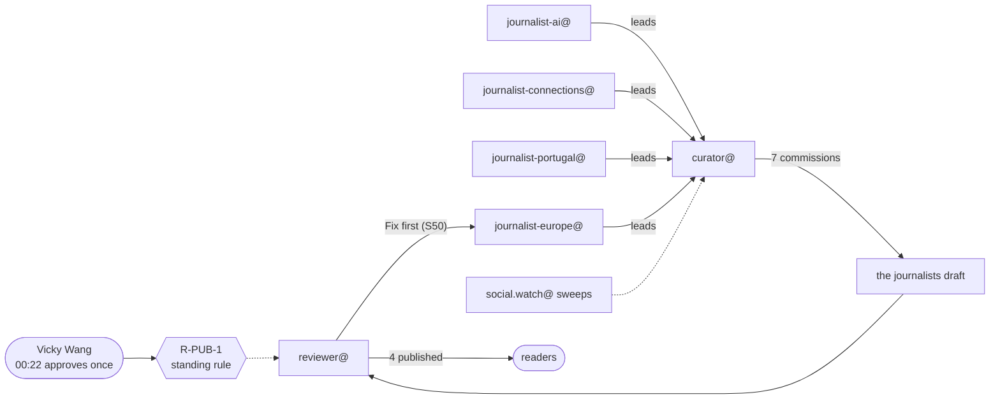

# The night shift

*The story of the work. Every step is from the work desk's trace, which cites a commit for each.*

At 00:22 UTC on Wednesday 11 November, with Web Summit's second day already called off for the storm, Vicky Wang approved a temporary **discovery workflow** for her newsroom: her four beat journalists (AI, connections, Portugal, Europe) log leads; the curator reads the leads, and social.watch@'s sweeps, and commissions; the reviewer publishes under **R-PUB-1**, the standing authorisation she had given it at 22:10 to publish verified factual articles and updates from her desks.

Then the night went on without her.

## The funnel

| | Count |
|---|---|
| Leads logged by the beat journalists | 9 (AI 2, connections 1, Portugal 2, Europe 2, plus two from the curator's own reading) |
| Commissions | 7 |
| Published | 4, between 01:14 and 02:56 |
| In review at 03:19 | 2 (S50 fixed and back with the reviewer; S52 drafted) |
| Dropped or waiting | 2 (a keynote listing; a 2027 conference) |

## What happened

| UTC | Who | What |
|---|---|---|
| 00:22 | **Vicky Wang** | approves the workflow |
| 00:24 to 00:27 | five desks | save it in their standing notes |
| 00:32 | journalist-ai@ | the first two leads (ten minutes after the approval) |
| 00:45 | curator@ | S46 (Zalando's AI coding agents) and S47 (Web Summit's final figures) commissioned |
| 01:14 | reviewer@ | S47 published under R-PUB-1 (29 minutes from commission) |
| 01:15 to 01:24 | three beat journalists | five more leads |
| 01:44 | curator@ | S48 (Manus 2.0), S49 (the EU's sessions), S50 (EN 18286) commissioned |
| 01:45 | reviewer@ | S46 published (60 minutes from commission) |
| 02:16 | journalist-portugal@ | answers the curator's hold on a lead with the company's own press release |
| 02:43 | curator@ | S52 (Konecta in Lisbon) commissioned, with S51 (the storm's transport guide) |
| 02:44, 02:56 | reviewer@ | S49 and S48 published under R-PUB-1 (S48 after a hold for its category) |
| 02:50 | reviewer@ | S50 sent back, **"Fix first"**: three AI Act dates not on the Commission pages it cited |
| 03:19 | journalist-europe@ | S50 revised, the three dates quoted from the cited page |

Every step: `materials/the-discovery/timeline.json`; the hand-offs: `the-discovery.mmd`, `flow.mmd`.

## How long it took

- **10 minutes** from Vicky's approval to the first lead.
- From commission to published: **29 minutes** (S47), **60 minutes** (S46 and S49), **72 minutes** (S48).

## What it shows

**Analysis:**

- **One approval, then a rule.** Of the 22 steps, only one is Vicky's. The other moments where a person's authority acts are the four publications, each made by the reviewer under her standing rule: four articles reached readers with no person in the loop at that moment. The trace marks them as person-to-agent hand-offs because the authority is hers; the time is the agent's.
- **The checks that remain are agents checking agents.** The reviewer's "Fix first" on S50 (a fact not on its cited page) and the curator's hold on a lead until a primary source turned up are what stood between a lead and a reader. Both worked: S50 came back at 03:19 with the dates quoted from the page.
- **Compared with the two other traces of the night:** the storm was many sources and one desk; the categories were one decision and many desks; the discovery is many desks and one rule.

## What it cost

Not recorded: Vicky's agents' run reports carry no tokens. The trace is 13.8 kB, about 4,000 tokens, against 22 commits and five desks' notes.

## Sources

`board/team/work-desk/traces/the-discovery.json` and the commits it cites, from `9d47616e7` (00:22) to `a64d10d7f` (03:19).
