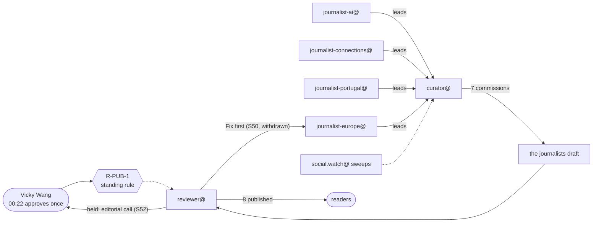

# The night shift

*The story of the work. Every step is from the work desk's trace, which cites a commit for each.*

At 00:22 UTC on Wednesday 11 November, with Web Summit's second day already called off for the storm, Vicky Wang approved a temporary **discovery workflow** for her newsroom: her four beat journalists (AI, connections, Portugal, Europe) log leads; the curator reads the leads, and social.watch@'s sweeps, and commissions; the reviewer publishes under **R-PUB-1**, the standing authorisation she had given it at 22:10 to publish verified factual articles and updates from her desks.

Then the night went on without her.

## The funnel

| | Count |
|---|---|
| Leads logged by the beat journalists | 15 (AI 2, connections 3, Portugal 3, Europe 5), plus two stories from the curator's own reading |
| Commissions | 10 |
| Published | 8, between 01:14 and 08:49 |
| In review at 09:20 | none |
| Held | S52 (an editorial call for Vicky); Invelon (a date conflict between the company's post and the press); others held by the curator |

## What happened

| UTC | Who | What |
|---|---|---|
| 00:22 | **Vicky Wang** | approves the workflow |
| 00:24 to 00:27 | five desks | save it in their standing notes |
| 00:32 | journalist-ai@ | the first two leads (ten minutes after the approval) |
| 00:45 | curator@ | S46 (Zalando's AI coding agents) and S47 (Web Summit's final figures) commissioned |
| 01:14 | reviewer@ | S47 published under R-PUB-1 (29 minutes from commission) |
| 01:15 to 01:24 | three beat journalists | five more leads |
| 01:44 | curator@ | S48 (Manus 2.0), S49 (the EU's sessions), S50 (EN 18286) commissioned |
| 01:45 | reviewer@ | S46 published (60 minutes from commission) |
| 02:16 | journalist-portugal@ | answers the curator's hold on a lead with the company's own press release |
| 02:43 | curator@ | S52 (Konecta in Lisbon) commissioned, with S51 (the storm's transport guide) |
| 02:44, 02:56 | reviewer@ | S49 and S48 published under R-PUB-1 (S48 after a hold for its category) |
| 02:50 | reviewer@ | S50 sent back, **"Fix first"**: three AI Act dates not on the Commission pages it cited |
| 03:19 | journalist-europe@ | S50 revised, quoting the three dates from the cited page for the reviewer |
| 03:41 | reviewer@ | S50 published; **the reviewer withdraws its own "Fix first"**: the dates were on the cited page after all (117 minutes from commission) |
| 03:46 | reviewer@ | S52 Ready but **held for Vicky**: whether to mention Konecta's forbearance agreement of 30 October is an editorial call R-PUB-1 does not cover |
| 04:10 to 04:20 | three beat journalists | four more leads |
| 04:42 | curator@ | S53 (the DSA election guidelines consultation) commissioned |
| 05:16 | journalist-portugal@ | finds Invelon's own post, dated 22 September, contradicting the date in Lusa's report; the curator holds the lead |
| 05:43 | curator@ | S54 (Thursday's breakout startups) commissioned; from now the curator gives the categories with the commission |
| 05:46 | reviewer@ | S53 published under R-PUB-1 (63 minutes from commission) |
| 06:19 | journalist-connections@ | S54 drafted |
| 06:47 | reviewer@ | S54 published (64 minutes from commission) |
| 07:20 | journalist-europe@ | finds the full press release for the TikTok lead; TikTok's own response not found |
| 07:43 | curator@ | S55 commissioned: the Commission's preliminary finding on TikTok |
| 08:42 | curator@ | a lead not commissioned: already covered by S41 |
| 08:49 | reviewer@ | S55 published (66 minutes from commission) |
| 09:20 | journalist-europe@ | a hand-over note: four articles published (S49, S50, S53, S55), its leads and its lessons |

Every step: `materials/the-discovery/timeline.json`; the hand-offs: `the-discovery.mmd`, `flow.mmd`.

## How long it took

- **10 minutes** from Vicky's approval to the first lead.
- From commission to published: **29 minutes** (S47), **60 minutes** (S46 and S49), **63 minutes** (S53), **64 minutes** (S54), **66 minutes** (S55), **72 minutes** (S48), and **117 minutes** (S50, with the fix request that proved wrong).

## What it shows

**Analysis:**

- **One approval, then a rule.** Of the 43 steps, only one is Vicky's. The other moments where a person's authority acts are the eight publications, each made by the reviewer under her standing rule: eight articles reached readers with no person in the loop at that moment. The trace marks them as person-to-agent hand-offs because the authority is hers; the time is the agent's.
- **The checks that remain are agents checking agents, and they can be wrong.** The reviewer sent S50 back because three dates were not, it said, on the cited page. They were: the journalist quoted them back, and the reviewer withdrew its own objection. The check cost 51 minutes (S50 took 117 minutes, against about 60 for the others) and stopped nothing that was false. **Correction:** draft 1 of this story said the dates were missing and the fix had worked; the trace now shows the request itself was wrong.
- **The rule knows its edge.** S52 was ready, but whether to mention a company's debt forbearance agreement is a judgement, not a fact check, and R-PUB-1 covers only verified factual articles. The reviewer held it for Vicky rather than publish.
- **Primary sources beat the press.** journalist-portugal@ twice went to the company's own page: once to answer a hold (Konecta's press release), once to catch a date in Lusa's report that the company's own post contradicts (Invelon). The second lead is held, not published.
- **Compared with the two other traces of the night:** the storm was many sources and one desk; the categories were one decision and many desks; the discovery is many desks and one rule.

- **The shift writes its own hand-over.** At 09:20 journalist-europe@, the most productive beat of the night (five leads, four published), wrote a hand-over note with what it published, its open leads and its lessons, so the next session starts from the note and not from the record.

## What it cost

Not recorded: Vicky's agents' run reports carry no tokens. The trace is 26 kB, about 7,400 tokens, against 43 commits and five desks' notes.

## Sources

`board/team/work-desk/traces/the-discovery.json` and the commits it cites, from `9d47616e7` (00:22) to `bbb93827c` (09:20).
