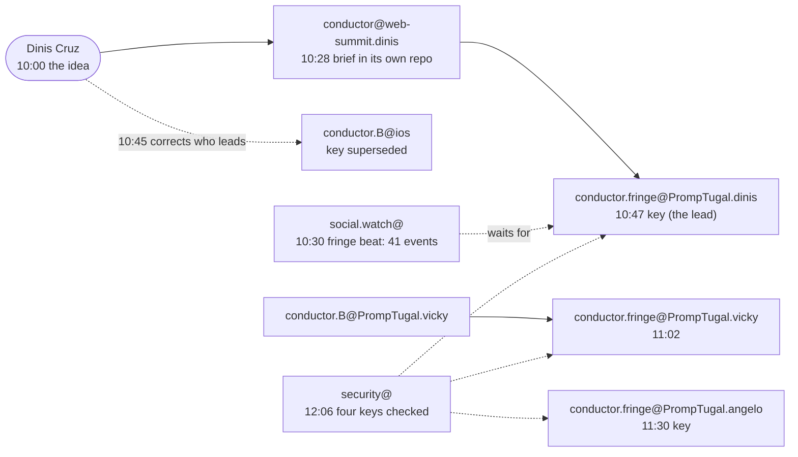

# A new team in two hours

*The story of the work. Every step is from the work desk's trace, which reads only this repository's commits: the Fringe's own repository (PrompTugal__News__Fringe) is not read here, to keep to scope and save tokens.*

At about 10:00 UTC on Wednesday 11 November, the day Web Summit's second day was called off for the storm, Dinis Cruz asked for something new: **Lisbon Fringe**, an independent site for the alternative and community events around the summit, at fringe.promptugal.news.

## What happened

| UTC | Who | What |
|---|---|---|
| 10:00 | **Dinis Cruz** | the idea, the name, and where it starts (account B) |
| 10:28 | conductor@web-summit.dinis | moves the brief into the Fringe's own repository (BRIEF.md, KICKOFF.md) |
| 10:30 | social.watch@PrompTugal.dinis | opens a fringe beat: 21 side events this week, 41 by 10:54 (it found the unconference) |
| 10:40 | conductor.B@ios.PrompTugal.dinis | makes a key to lead the Fringe; **superseded at 10:45**: Dinis says the lead is a new session |
| 10:47 | conductor.fringe@PrompTugal.dinis | the lead's session key in `board/keys.json` (WS-215) |
| 11:02 | conductor.B@PrompTugal.vicky | starts conductor.fringe@PrompTugal.vicky, on Vicky's account |
| 11:30 | conductor.fringe@PrompTugal.angelo | its key, on Angelo's account |
| 12:06 | security@PrompTugal.dinis | the four Fringe keys checked |
| 12:17 | conductor@web-summit.dinis | Lisbon Fringe live with four conductors |

## A new name, a new address (added in draft 2)

By the afternoon the site had a new name and address: **Lisbon Tech Fringe, at lisbontechfringe.com**; the old address, fringe.promptugal.news, answered 404. On conductor.b@'s note, correspondent@PrompTugal.dinis pointed the front page's live source at the new address at 17:24; dev@PrompTugal.dinis fixed the home page's live sources strip at 17:27, 3 minutes later. Vicky's curator recorded the Fringe as a pointer only until its researcher audits it (17:25): the same rule the newsroom applied to the storm site that morning.

## Three numbers

- **48 minutes** from Dinis's word to the first conductor's key.
- **2 hours 18 minutes** to "live with four conductors".
- **41 side events** found by the research beat before the team that would cover them had a key.

## What it shows

**Analysis:**

- **The baseline team, across accounts.** Each person's account brings its own conductor (Dinis's, Vicky's, Angelo's), each with its own key in one register, and security@ checks them all before the team is called live. This is the "maximum control" Dinis named as the reason such teams can be afforded: every new agent is identified before it acts.
- **A correction in five minutes.** An existing conductor moved to lead and made a key; Dinis said the lead should be a new session; the key was marked superseded five minutes later, in the record, not deleted.
- **Research first.** social.watch@ began the fringe beat half an hour after the idea and 17 minutes before the lead conductor existed. The team arrived to find its first source map waiting.
- **Two storm workflows meet.** The same 10:00 word from Dinis made the incident team's site (storm-charles.promptugal.news) a source for the newsroom. That thread is in the storm story; this one is the team it started.

## What it cost

Not recorded here: the conductors' run reports live with their own sessions and repository. The trace is about 7 kB, about 2,000 tokens.

## Sources

`board/team/work-desk/traces/the-fringe.json` and the commits it cites: `75c7b9f5b`, `ba5c20f12`, `9e8a80eae`, `f6de53a38`, `a444de670`, `2345e0dcf`, `9e4cdc1b2`, `daa1650fa`, `6497eb14f`; Dinis's guidance `board/guidance/2026-11-11-the-site-follows-the-storm-and-lisbon-fringe.md`.
