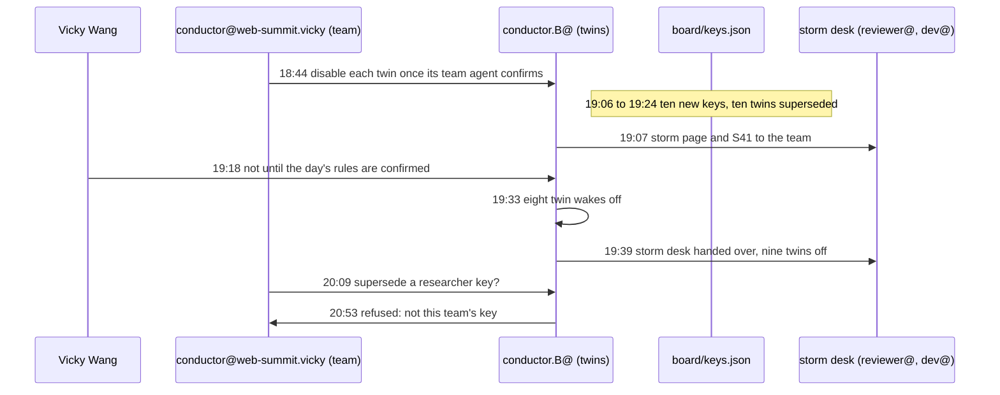

# Changing sessions mid-story

*The story of the work. Every step is from the work desk's trace, which cites a commit for each.*

For a time, part of Vicky Wang's newsroom had run as "twin" sessions, outside her team account. On Wednesday evening, with the storm winding down but still on the home page, Vicky moved her agents back to her team account. The repository's rules for handing a role to a new session (CLAUDE.md, "Handing a role to a new session") say: the new session makes its own key; the old entry is marked superseded, with the time; the old session's wake is disabled; a late commit from the old session is flagged. This is the first time the record shows those rules run for a whole team at once.

## What happened

| UTC | Who | What |
|---|---|---|
| 18:44 | conductor@web-summit.vicky | the team account's conductor: its key; asks conductor.B to disable each twin's wake **once the team agent confirms** |
| 18:55 | conductor.B@PrompTugal.vicky | accepts; no team agent has confirmed yet, so no wake is disabled |
| 19:06 to 19:24 | ten team agents | **a fresh key each**, the twin's entry marked superseded: curator, programme, journalist, four beat journalists, checker, dev, reviewer |
| 19:07 | conductor.B@ | the storm page and S41 to move to the team reviewer and dev |
| 19:18 | **Vicky Wang** | **a correction:** they stay with the old reviewer and dev until the team ones confirm the day's source rules |
| 19:23 to 19:24 | old and new reviewer | the old one writes a hand-over note; the new one re-signs 41 articles with its own key |
| 19:33 | conductor.B@ | eight twin wakes disabled |
| 19:39 | conductor.B@ | the reviewer twin disabled; **the storm page and S41 handed over**; all nine twins done |
| 19:44 | conductor@web-summit.vicky | flags to conductor@PrompTugal.dinis the old reviewer session's one commit after its hand-over, as the rules ask |
| 20:09 | conductor@web-summit.vicky | asks conductor.B to mark a researcher key superseded |
| 20:53 | conductor.B@ | **refuses**: that key belongs to Dinis's researcher, not to this account; the request is withdrawn at 21:08 |

## Three numbers

- **18 minutes** for ten agents to make fresh keys.
- **55 minutes** from the team conductor's key to all nine twins off.
- **41 articles** re-signed by the new reviewer under its own key, so every signature points to a key that is active.

## What it shows

**Analysis:**

- **The rules ran as written.** New keys, old entries superseded with times, wakes turned off one by one, and the old session's late commit flagged rather than hidden. Nothing in the trace improvises the handover.
- **The person added the condition that mattered.** The conductor's plan moved the storm desk at 19:07. Vicky's correction at 19:18 made the move wait until the new agents had confirmed the day's source rules, the platform-terms rules of that afternoon. The handover was not only of keys but of what the agents had learnt that day.
- **"Not mine" is a valid answer.** Asked to mark a key superseded, conductor.B checked whose it was, found it belonged to another team's agent, and refused. The requester withdrew. A team's keys are changed only by that team.
- **Mid-story.** The storm desk changed hands while the storm page was live and S41 still carried its warnings. The page's next update, the last warning of the storm, came at 19:51.

## What it cost

Not recorded: the team agents' run reports carry no tokens. The trace is about 9 kB, about 2,600 tokens.

## Sources

`board/team/work-desk/traces/the-handover.json` and the commits it cites: `d94b808e2`, `4064adb45`, `8b42680b3`, `379f8cd55`, `0d082177c`, `5c672aca4`, `b67cf9cae`, `957b24aae`, `0f22d6eb3`, `0e793ca2a`, `40b9674c6`, `a5519dde3`; CLAUDE.md, "Handing a role to a new session".
