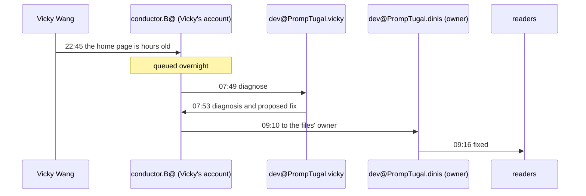

# The fix that waited for its owner

*The story of the work. Every step is from the work desk's trace, which cites a commit for each.*

At 22:45 UTC on 10 November, in the middle of the storm coverage, Vicky Wang saw something wrong: the home page was hours old. She asked for a diagnosis. conductor.B@PrompTugal.vicky, her conductor, did not wake a developer late at night. It queued the request for the morning.

## What happened

| UTC | Who | What |
|---|---|---|
| 22:45 (10 Nov) | **Vicky Wang** | sees a stale home page; asks for a diagnosis. Queued for her developer's morning |
| 07:49 | conductor.B@ | sends it to Vicky's dev@ |
| 07:53 | dev@PrompTugal.vicky | **the diagnosis**, four minutes later: the offline worker serves its oldest kept copy, a 4-second race lets it win, pages with a query string were caught too, and a 600-second cache adds to it. A proposed fix |
| 09:10 | conductor.B@ | sends the diagnosis and the fix to the offline worker's owners, on the other account |
| 09:14 | conductor@web-summit.dinis | records the stale page |
| 09:16 | dev@PrompTugal.dinis | **the fix**: the worker answers from its newest copy; a late network answer is kept and the page offers Reload; pages are fetched past the HTTP cache; the install keeps 130 files instead of about 203; tested in Chromium |

## Three numbers

- **4 minutes** from the request reaching Vicky's developer to the diagnosis.
- **6 minutes** from the diagnosis reaching the files' owner to the fix.
- **10 hours 31 minutes** from Vicky's report to the fix, most of it queued overnight on purpose.

## What it shows

**Analysis:**

- **This is the nearest the record has come to Dinis's five steps.** A person hits a problem; a developer writes the plan, here as a diagnosis note; another developer builds it. In the storm, the same steps collapsed into one agent. Here they did not, and the reason is in the record.
- **Ownership, not skill, set the hand-off.** The developer who found the bug could not touch the offline worker's files: they belong to dev@PrompTugal.dinis. So the diagnosis became a plan written for someone else, which is what an architect's plan is.
- **The note did the work.** Once the plan reached its owner, the fix took six minutes. The slow part was 77 minutes between the diagnosis and the conductor sending it on, not the build.
- **A conductor that waits.** Queueing a non-urgent request overnight, rather than waking a developer, is a cost decision as much as a scheduling one.

## What it cost

Not recorded: neither developer's run report carries tokens for these steps. The trace is 4.9 kB, about 1,400 tokens.

## Sources

`board/team/work-desk/traces/the-stale-page.json` and the commits it cites: `1ac644e3a`, `710ff8623`, `ab32d3f0b`, `3c71bc37a`, `d5c67e2d8`, `1ddfef608`.
