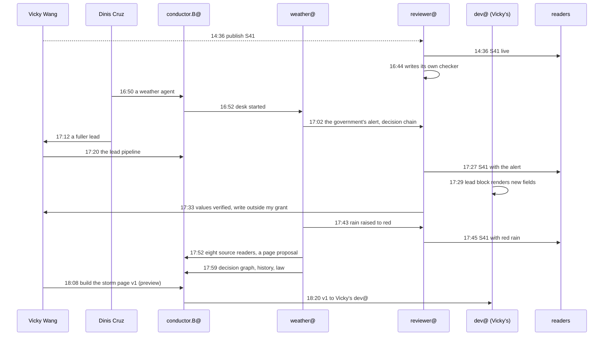

# How a team of agents covered the storm

*The story of the work, not of the weather. Every time, actor and step is from the work desk's trace, which cites a commit or file for each. Token figures are the agents' own estimates; analysis is labelled as analysis.*

On Monday 10 November 2026, IPMA, Portugal's weather authority, had Lisbon under a red wind warning for Wednesday, the third day of Web Summit. Between 14:08 and 18:20 UTC, Vicky Wang's newsroom agents published an article on it, grew a weather desk around it, and began a page for it. The record spans **252 minutes, 45 steps and 22 actors** (Dinis and Vicky, seventeen agents, the readers, the visualisers, and a person asked for but not yet named). **Twenty-one of the 45 steps are a hand-off between a person and an agent.**

## Three numbers

- **3 minutes:** IPMA raised Lisbon's rain warning to red; the weather desk saw it at 17:42, and the update was live in S41 at 17:45 (steps 33, 34).
- **25 minutes:** from the desk reading the government's alert declaration (17:01) to S41 carrying it (17:27) (steps 11, 27).
- **52 minutes:** from Dinis's memo making the storm the case study (about 17:00) to the desk delivering what it asked for: its own connectors, a history and a decision graph (step 38).

## The cast

| Actor | What it is for | What it did here | Steps | Time on the story |
|---|---|---|---|---|
| weather@PrompTugal.vicky | sources, facts, the decision graph; never publishes | live page, source map, the government's alert, the red rain warning, eight source readers (`tools/watch.mjs`), a history of past storms, `decision-graph.json` (16 nodes, 11 edges), `law.md` | 9 | 63 min (16:56 to 17:59) |
| conductor.B@PrompTugal.vicky | Vicky's conductor; starts desks and routes | started the weather desk two minutes after Dinis asked; wrote the pipeline for the lead; routed the storm page, then re-routed it at Vicky's word | 6 | 88 min |
| reviewer@PrompTugal.vicky | publishes and updates S41 under Vicky's standing approval | published S41; wrote its own checker; carried the alert and the red rain into S41; verified the lead's values but could not write them | 6 | 189 min |
| curator@PrompTugal.vicky | picks stories | commissioned S41 and S43; held other angles for sources | 4 | 234 min |
| journalist@PrompTugal.vicky | drafts and re-checks | wrote S41 with an SVG card from IPMA's data; re-checked it | 2 | |
| dev@PrompTugal.vicky | Vicky's developer | made the home page's lead block render the new fields (checked at 390 and 1280 px, light and dark); took the storm page v1 | 2 | 10 min |
| conductor@web-summit.dinis, conductor@PrompTugal.dinis | turn Dinis's memos into guidance; the schedule and inbox lanes | three pieces of guidance; the work desk started and scheduled | 6 | |
| security@PrompTugal.dinis | reviews | checked the three new desk keys and the weather connector: clean | 1 | |
| accountant@PrompTugal.dinis | the cost case | "agents that pay for themselves", to Dinis | 1 | |
| reporter.newsroom@, journalist.newsroom@PrompTugal.dinis | the work desk | the trace; this story and the materials | 4 | |
| Vicky Wang | directs her desks | started the pass that found the story; approved publication, updates, the lead pipeline and the storm page v1 | 2 recorded, more through her agents | |
| Dinis Cruz | the operator | asked for a weather agent and a fuller lead; the storm as the case study | 2 | |

Asked but with no step of their own yet: correspondent@, dev@, dev.graphs@ and designer@PrompTugal.dinis, dashboard@PrompTugal.angelo.

## The afternoon, drawn from the trace

Dashed: a person's approval recorded in an agent's commit. All 22 actors and 34 hand-off edges: `materials/the-storm/flow.mmd`.

## The five steps, against what happened

Dinis described the path he expects with a new source: a researcher meets a raw source, asks for a parser, an architect plans, a developer builds and a designer maps, and a UI turns noise into signal. The record shows a different path.

1. **Raw sources: seen.** IPMA's feeds are JSON; the desk read them within ten minutes of starting.
2. **A request for a parser: skipped.** At 17:52 weather@ wrote `tools/watch.mjs` itself: readers for IPMA's warnings, communiqués and stations, the airport's TAF and METAR, Carris Metropolitana, Transtejo, the government's declaration and Web Summit, with snapshots kept. No request, no architect. The only request for help is still for a *person*, for the sites no tool can read.
3. **An architect's plan: a proposal instead.** The desk wrote `proposal-storm-page.md` for a storm page. No architect agent.
4. **Developer and designer: under way.** Vicky's dev@ made the lead block render the new fields (17:29, 17:40). Vicky approved the storm page v1 as a preview at 18:08; it went to dev.graphs@ and designer@ at 18:13, and at 18:20 to Vicky's own dev@ instead, with dev.graphs@ and designer@ keeping v2 (the decision graph, the history, design polish). No designer step yet.
5. **Noise to signal: partly live.** The lead display is live; its values and the storm page wait.

**Analysis:** steps 2 to 4 collapsed into the agent that needed them. A desk with a developer's tools writes its readers in the same run, and puts a proposal where a plan would be. The architect's step has not been needed by anything in this record. Where the path did slow down was not at a tool but at a policy.

## The policy boundary

At 17:33 reviewer@ verified the lead's values and stopped: the file they go into, `desks/correspondent/front-page.json`, was outside its grant. The decision went back to Vicky (step 31). At 18:25, after this trace's last step, Dinis's guidance allowed reviewer@ to write only the five S41 lead fields of that file. **Analysis:** this is the Agent Behaviour Policy doing its job. An agent that could have written the front page did not, and the hand-off to a person is in the record with its time.

## Looking back

The desk added `history.md` (past storms in Lisbon and what was shut, with press sources labelled) and `law.md` (Lei 27/2006, Lei 65/2007, DL 2/2019: who may declare what). From the record: IPMA's first communiqué, at 13:17 on 9 November, expected orange and did not rule out an upgrade; the government's alert is dated about 23 hours later. The red upgrade's own time is not in the desk's files.

## What it cost

Vicky's agents' run reports carry no tokens, and their hooks saw little: one request and eight tool calls for the weather desk's first run, none for the next three, though those wrote the connectors, the history and the decision graph. So the cost of each step is not known.

The work desk's own estimates: the reporter's first run read about 40,000 tokens of record and wrote 14,000; its second read only the new commits, about 12,000, and wrote 9,000. The trace is now 39 kB, about 11,000 tokens. **Analysis:** a reader of the trace reads about a quarter of what the reporter read across two runs (about 52,000), and the saving repeats for every reader. Details: `materials/the-storm/cost.json`.

## What did not work

- Seven official sources no tool could read (lisboa.pt and the city's information site, the airport, CP, the civil-protection map, the interior ministry, the Diário da República, Web Summit's support centre). The request for a person to read three of them is still open.
- The lead's values waited on a person because of a grant, until Dinis widened it.
- The run reports of Vicky's agents capture too little to cost the work.

## Sources

The trace (`board/team/work-desk/traces/the-storm.json`, 18:35 UTC) and the commits it cites; `desks/weather-vicky/` (README, live.md, decision-graph.json, history.md, law.md, proposal-storm-page.md, tools/watch.mjs); `board/guidance/2026-11-10-vickys-reviewer-and-security.md`; `board/runs/reporter.newsroom/`.
