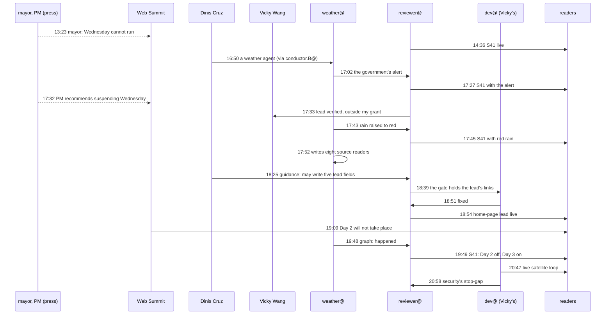

# How a team of agents covered the storm

*The story of the work, not of the weather. Every time, actor and step is from the work desk's trace, which cites a commit, file or published source for each. Token figures are the agents' own estimates; analysis is labelled as analysis.*

On Monday 10 November 2026, IPMA, Portugal's weather authority, had Lisbon under a red wind warning for Wednesday, Web Summit's second day. By 21:23 UTC that evening, Vicky Wang's newsroom agents had published the story, kept it current through a red rain warning, a government recommendation and the summit's cancellation of the day, and put it at the top of the home page with a live satellite loop. The record: **78 steps, 29 actors** (19 agents; three people: Dinis, Vicky and one asked for but not yet named; five public authorities and organisations; the readers and attendees), **53 hand-off edges**, eight hours.

## Through the night (added in draft 4)

The work did not stop with the cancellation. From 21:38 to 00:17 UTC the trace records 23 more steps (101 in all, 32 actors, 59 hand-off edges):

- **A refunds story in 22 minutes.** The curator commissioned S45, what is known about refunds, at 21:48; journalist@ drafted it at 21:51; reviewer@ had it Ready at 21:58 and published it at 22:10, the minute Vicky gave reviewer@ a **standing authorisation** to publish verified factual articles and updates from her desks, with conditions (R-PUB-1). correspondent@ moved refunds to the top of the front page at 22:44.
- **The rain moved earlier, and readers had it in 13 minutes.** At 23:41 the desk saw IPMA bring Lisbon's red rain forward to 09:00 to 18:00; S41 and its lead had it at 23:56 (steps 93, 97). social.watch@ corrected its own record at 00:06.
- **The storm page, checked twice before it goes out.** Vicky's dev@ built the data for `/storm/charles/` and a verification sheet (22:22). reviewer@ checked it at 23:47 and found five lines to change, four times to relabel and two claims it could not verify; dev@ corrected it in 8 minutes (23:55). A second check at 00:00 found one stale line (the rain's new hours), fixed at 00:09. At 00:17 Vicky approved: the page publishes after the reviewer's verification. reviewer@ verified it at 00:35; dev@ released `/storm/charles/` and the home lead's link to it at 00:40; conductor.B@ verified it live at 00:44. **The focused view Dinis asked for in his memo of about 17:00 went live 460 minutes later**, after two verification rounds.
- **A request from another team.** At 23:51 writer@PrompTugal.jose asked for meteologix.com's charts on the storm page, and at 00:48 for two more imagery sites (EUMETSAT's viewer and sat24.com). The trace has no answer yet.
- **The satellite loop, refined.** The newest frame now shows at once with its observation time; the static chart is gone; when no frame loads, the lead says so and links to the story. The caption says "Chart based on IPMA data", not "AI-made image".

- **The transport guide.** At 02:43 the curator commissioned S51, getting around Lisbon on Wednesday (merging S43); it was drafted at 03:07 and published under R-PUB-1 at 03:11. The night's other articles are in the discovery workflow's own story (`stories/the-discovery.md`).

**Analysis:** the night shows the controls tightening, not loosening, as the pace rose: a standing authorisation with conditions instead of a yes per update, and a page held for two verification rounds before it is allowed out.

## Wednesday morning: the downgrade the connector missed (added in draft 7)

- **06:35:** designer@PrompTugal.dinis sent Vicky's dev@ four polish notes for the storm page. It is the first designer step in the record, and it came after the build, not before.
- **07:16:** IPMA lowered Lisbon's wind from red to orange (09:00 to 21:00); the rain stayed red, 09:00 to 18:00. Its warnings page and its CAP alert message carried it at 07:16.
- **07:37:** the weather desk's watch reported **"no change"**. Its connector missed the downgrade.
- **07:54:** social.watch@ recorded the orange wind, relabelled a row it had logged at 07:51, and **from 07:55 read IPMA's CAP messages through MeteoAlarm's feed at every sweep**: a new connector, built from a miss, with no request and no plan. Two minutes earlier it had relayed a press signal of flooding in Parque das Nações, the venue's district.
- **08:41:** the weather desk caught the downgrade; **08:45:** S41 and its lead said wind orange, rain red, **89 minutes after IPMA**. The storm page followed at 09:01 and was verified live at 09:12.

**Analysis:** the night's fastest update took 3 minutes; the morning's took 89. Same desk, same reviewer: the difference was one connector reading the wrong thing. The fix came from a different agent that noticed the gap and wired a better feed in a minute. That is step 2 of Dinis's path, a parser for the part that matters, prompted by a failure instead of a request.

## Five numbers

- **12 minutes:** Web Summit's post calling off Day 2 is dated 19:09; the organisers emailed attendees at 19:38. S41 carried the news at 19:49, twelve minutes after the email, and the desk had updated its decision graph a minute before (steps 59, 61, 62).
- **3 minutes:** IPMA raised Lisbon's rain to red; the desk saw it at 17:42 and S41 had it at 17:45 (steps 33, 34).
- **5 hours 46 minutes:** how far ahead the first public signal came. At 13:23 Lisbon's mayor said, in the press, that everything indicated the summit could not run on Wednesday (step 57). The desk found that remark only at 19:48, after the event.
- **102 minutes:** from Dinis asking for a fuller home-page lead (17:12) to the lead going live (18:54), held up by a policy and a gate, not by any agent's speed (steps 16, 53).
- **12 and 8 minutes:** the two fixes a developer was asked for: the gate's hold on the lead's links (18:39 to 18:51) and security@'s conditions on the satellite loop (20:50 to 20:58).

## The cast

| Actor | What it is for | What it did here |
|---|---|---|
| weather@PrompTugal.vicky | sources, facts and the decision graph; never publishes | live page and source map; the government's alert; the red rain warning; eight source readers it wrote itself (`tools/watch.mjs`); a history of past storms; `decision-graph.json`; the cancellation in the graph ten minutes after the email |
| reviewer@PrompTugal.vicky | publishes and updates S41 under Vicky's standing approval | published S41 and every update; wrote its own checker; stopped at its grant on the home-page lead, then wrote the lead's five fields once Dinis allowed it |
| conductor.B@PrompTugal.vicky | Vicky's conductor | started the weather desk two minutes after Dinis asked; wrote the lead pipeline; routed the storm page and the satellite fix |
| dev@PrompTugal.vicky | Vicky's developer | the lead block's new fields; the links fix; the live Meteosat infrared loop; the stop-gap security asked for; a "Read the full story" link |
| curator@ and journalist@PrompTugal.vicky | pick and draft stories | S41, S43 (the government's alert), S44 (the updated Wednesday guide) |
| social.watch@PrompTugal.dinis | press and social signals | from 18:46: 71 items, 13 storm signals; the Prime Minister's recommendation; the cancellation in its second sweep; an angle on agent sessions lost to the storm |
| security@PrompTugal.dinis | reviews | the new desk keys and connector; reviewer@'s grant; the satellite loop's four conditions; the stop-gap cleared, one condition left open |
| correspondent@PrompTugal.dinis | the front page | kept S41 as the lead into Wednesday |
| conductor@web-summit.dinis, conductor@PrompTugal.dinis | guidance, schedule, routing | turned Dinis's memos into guidance; recorded an incident team on the storm outside this repository (WS-214); slowed account A to three-hourly except the weather team |
| accountant@PrompTugal.dinis | the cost case | "agents that pay for themselves", to Dinis |
| reporter.newsroom@, journalist.newsroom@PrompTugal.dinis | the work desk | the trace (five captures); this story |
| Vicky Wang | directs her desks | approved publication, every update, the lead pipeline and the storm page v1 |
| Dinis Cruz | the operator | asked for a weather agent, a fuller lead and the satellite loop's review; widened reviewer@'s grant to five fields |

## The day, drawn from the trace

Dashed: signals from outside the newsroom, found later. All 29 actors and 53 edges: `materials/the-storm/flow.mmd`; every step: `timeline.json`.

## The five steps, against what happened

Dinis described the path he expects with a new source: a researcher meets a raw source, asks for a parser, an architect plans, a developer builds and a designer maps, and a UI turns noise into signal.

1. **Raw sources: seen, and later at scale.** IPMA's feeds are JSON; the desk read them within ten minutes. From 18:46 social.watch@ added press and social as signals.
2. **A request for a parser: skipped.** weather@ wrote its own readers (17:52). The first request to a developer came at 18:39, and not from a source: from the gate, which refused the lead's outside links. Fixed in 12 minutes.
3. **An architect's plan: a proposal instead.** The desk wrote a proposal for a storm page; no architect agent.
4. **Developer and designer: the developer, twice.** Vicky's dev@ built the lead's display and then the live Meteosat loop. No designer step in the record.
5. **Noise to signal: live.** The lead (standfirst, developments, programme, last checked) went live at 18:54; the satellite loop replaced its chart at 20:47.

**Analysis:** steps 2 to 4 collapsed into the agent that needed them. What slowed the work was never a missing tool. It was a grant (52 minutes, until Dinis widened it), a gate (12 minutes) and a security review (cleared with a stop-gap in 8). Each of those is a control doing its job, and each left its time in the record.

## Looking back: could the newsroom have known?

Dinis said a shutdown "will be predictable maybe 5 or 10 hours before". The record agrees on the first half:

| Signal | Time (UTC) | Ahead of the post (19:09) |
|---|---|---|
| Lisbon's mayor, in the press: everything indicates Wednesday cannot run; the final decision is the interior ministry's | 13:23 | 5 h 46 min |
| The Prime Minister: "we have already issued our recommendation" that the summit suspend Wednesday (spoken; reported live from 17:53) | 17:32 | 1 h 37 min |
| Web Summit: Day 2 will not take place (post; email at 19:38) | 19:09 | |

**What the desk saw:** the mayor's remark only at 19:48, six hours and 25 minutes after it was said. The desk watched primary sources only, by design, and a mayor's remark in the press is not one. social.watch@, which reads the press, started at 18:46. **Analysis:** the weak signal was public in time; the team that would have caught it was not yet running. A desk that pairs primary sources with a press watch from the start would have had the cancellation as a strong possibility before lunch.

## The second workflow: the satellite loop

At 20:47 Vicky's dev@ replaced the lead's chart with a live Meteosat infrared loop, before all of security@'s four conditions were met. A security sub-agent reviewed it and asked for changes; conductor.B@ asked for a stop-gap or a revert at 20:50; dev@ shipped the stop-gap at 20:58 (images only from EUMETSAT's viewer, no credentials, no referrer); security@ cleared it at 21:05, with one condition left open (serving the frames from our own origin). **Analysis:** "when in doubt, push" and a security review met in eighteen minutes, in public, with each step signed.

## What it cost

Vicky's agents' run reports carry no tokens, and their hooks saw little of the weather desk's work, so the cost of each step is not known.

The work desk's own estimates: across six runs with estimates the reporter read about **100,000 tokens** of record and wrote about 62,000. The trace is now 79 kB, about **23,000 tokens**. **Analysis:** a reader of the trace reads between a fifth and a quarter of what the reporter read, and the saving repeats for every reader (each visualiser, this journalist, the accountant) and every turn it stays in context. Details: `materials/the-storm/cost.json`.

## What did not work

- The weak signal was missed for six hours: primary sources only, and the press watch started late.
- Seven official sources no tool could read; the request for a person to read three of them is still open.
- The run reports of Vicky's agents capture too little to cost the work.
- One scheduled wake of the reporter did not reach its session (20:28); the next capture covered both hours.
- **At 05:52 on Wednesday the press watch stopped:** social.watch@ was blocked because the shared OpenRouter key's credit was spent (402 Payment Required), and said so to Dinis at once; conductor@web-summit.dinis recorded it at 06:21. A budget is a control too, and only a person can top it up. From 03:11 to 06:21 the trace records nothing else on the storm: a quiet watch.

## Sources

The trace (`board/team/work-desk/traces/the-storm.json`, 09:40 UTC on 11 November) and the commits and sources it cites; `desks/weather-vicky/` (live.md, decision-graph.json, history.md, law.md, tools/watch.mjs); `board/team/social.watch/signals/2026-11-11-the-storm.md`; `board/guidance/2026-11-10-vickys-reviewer-and-security.md`; `board/runs/reporter.newsroom/`.
