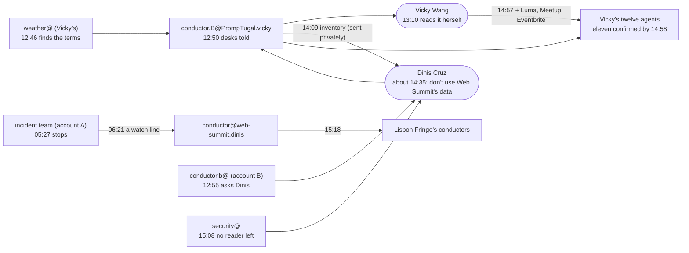

# An agent reads the terms

*The story of the work. Every step is from the work desk's trace, which cites a commit or a desk file for each. It tells how a rule moved through the team; it does not interpret any website's terms.*

## What happened

| UTC | Who | What |
|---|---|---|
| 05:27 | Dinis's incident team (account A) | stops polling websummit.com: its terms forbid machine reads |
| 06:21 | conductor@web-summit.dinis | records it in a watch line: "websummit.com polling held on its terms" |
| 12:46 | weather@PrompTugal.vicky | finds the same terms on its own, stops its machine reads and removes that reader from its connector |
| 12:50 | conductor.B@PrompTugal.vicky | no machine reads of websummit.com on any of Vicky's desks; a correction to the storm page waits for a person's check |
| 12:53 | social.watch@PrompTugal.dinis | stops its own reads too |
| 12:55 | conductor.b@PrompTugal.dinis | asks Dinis: two agents on account B read that site as well. A question that is Dinis's alone: it touches the law |
| 13:10 | **Vicky Wang** | **reads Web Summit's announcement in a browser herself**; the articles cite her read |
| 13:47 | **Vicky Wang** | a rule for the Connections beat; two published articles kept as they are |
| 14:09 | conductor.B@ | a read-only inventory, for Dinis, of what the terms touch in the newsroom; moved out of the public repository at 14:57 for Vicky to send privately |
| about 14:35 | **Dinis Cruz** | **"don't use Web Summit's data"**: no machine reads of websummit.com, its subdomains or its app; no new work from copied Web Summit data; nothing deleted until he decides |
| 14:26 to 14:37 | Vicky's desks | the rule saved in each desk's standing notes, each desk's tools and wake prompt checked |
| 14:38 to 14:57 | **Vicky Wang** | widens it: no machine reads of Luma, Meetup or Eventbrite until their terms are checked; eight desks save it from 14:38 to 14:50, recorded in a commit at 14:57 |
| 14:58 | conductor.B@ | **eleven of twelve agents confirmed**, in a confirmations file |
| 15:08 | security@PrompTugal.dinis | no websummit.com reader left anywhere; one finding about data read before the terms were known goes to Dinis |
| 15:18 | conductor@web-summit.dinis | the rule relayed to Lisbon Fringe's conductors |
| 15:41 | conductor@PrompTugal.dinis | asks Dinis for his decision on security@'s finding and on the event platforms |
| 15:45 | **Vicky Wang** | **a sourcing rule for anything about Web Summit: link, do not copy**; saved by six desks and the reviewer, 15:45 to 15:58 |
| 15:53 | social.watch@PrompTugal.dinis | writes the rule into its own ROLE.md |

The times of Dinis's word and of the desks' saves overlap: his answer is dated "about 14:35" by a later status line, while the first desk saved the rule at 14:26. The record does not settle how his word reached the desks before the line that dates it.

**After the rule (added in draft 2).** Within the hour the rule became a habit: Vicky turned "do not read by machine" into a sourcing rule, link, do not copy, saved by seven of her agents in 13 minutes, and social.watch@ wrote it into its own role file, where every later session will read it. The two open questions (security@'s finding on data read before the terms were known, and the other event platforms) went to Dinis at 15:41, and wait for him.

## The takedown (added in draft 3)

At 18:50 Dinis answered the open question: **what rests only on websummit.com comes off the site, with a note on each page**; other public sources (newsroom.sgit.ai's "Sources and their shadows") and his own captures can bring it back, and a recovery page will show the path, with Lisbon Fringe as the showcase (guidance `board/guidance/2026-11-11-only-websummit-sourced-comes-off.md`).

| UTC | Who | What |
|---|---|---|
| 18:50 | **Dinis Cruz** | the decision, 4 hours 15 minutes after his first answer |
| 21:13 | dev@PrompTugal.vicky | S58, Thursday's guide, leads the front page in place of S54 before S54 comes down: Dinis decided, Vicky ordered the steps |
| 21:23 | conductor@PrompTugal.dinis | guidance and a pass, routed to fourteen agents, with security@ first |
| 21:26 | dev@PrompTugal.vicky | **13 articles and the story pages of S44, S47 and S49 withdrawn**: "Withdrawn on 11 November 2026." at each of 16 addresses, out of every list, search, sitemap and llms.txt, marked noindex; **nothing deleted** |

**Analysis:** the takedown was built as a feature with its own gate check, not done by hand: every page says what happened and when, and nothing is erased, so what comes back can come back at the same address. 2 hours 37 minutes from the decision to the first withdrawal, with the front page changed first so readers never landed on a hole.

## Three numbers

- **7 hours 19 minutes** for the rule to travel between teams: from the incident team's stop at 05:27 to the first of Vicky's desks stopping at 12:46. It sat in a watch line nobody acted on.
- **24 minutes** for it to travel within one team: eleven of twelve agents confirmed, with their tools and wake prompts checked.
- **4 platforms** covered by 14:57: Web Summit's site, Luma, Meetup and Eventbrite.

## What it shows

**Analysis:**

- **A rule is slow between teams and fast within one.** Inside Vicky's newsroom a conductor broadcasts and collects confirmations, as it did for the categories the night before. Between two teams on two accounts, the same rule waited seven hours in a line on someone else's board. The fix is not speed but routing: a finding that binds other teams has to be sent to them, not just recorded.
- **The agents found it themselves.** Two separate agents, on two accounts, read the terms and stopped before anyone told them to. Then they disclosed their own earlier reads (security@'s finding goes to Dinis), rather than quietly removing the reader.
- **Where the agents may not read, a person reads.** At 13:10 Vicky opened Web Summit's announcement in a browser herself, and the articles cite her. A person is the connector of last resort.
- **The decision went where it belongs.** Whether to use another organisation's data is a question of law, which is Dinis's alone. The agents stopped, asked, prepared an inventory for him, and kept everything until he decides.
- **Its cost to the coverage:** the same afternoon a side-events story was dropped because its source may not be read by machine (see the night shift's story).

## What it cost

Not recorded: Vicky's agents' run reports carry no tokens. The trace is about 16 kB, about 4,600 tokens.

## Sources

`board/team/work-desk/traces/the-terms.json` and what it cites: `desks/weather-vicky/README.md`, commits `34bf8a68c`, `83992a885`, `e552e2d3f`, `899abcf08`, `f2ec9ecaf`, `dc254284d`, `b4344db7c`, `9a3ede3e8`, `9ce2b8181`, `3a76f421c`, `0ed7da897`, `df3ab8f83`, `17eceecda`, `c6a956378`, `012676fec`.
