**The ask.** Dinis, 10 November, about 02:40 UTC (`board/guidance/2026-11-10-the-restart.md`): *"A heavy design flip: modern, very Portuguese, at the quality of the investor decks."* The home page leads with "State of agentic": the GAMMA-Ray leaderboard and cards, then our content (the two interviews), then the graph in place of the company list.

**Corrected in round 2:** round 1 showed a ranked "leaderboard" with one score per company. GAMMA-Ray does not work that way (see round 2 below), so the leaderboards in A, B and C are wrong in shape, and only their layout is the proposal.

**The rules for round 1.**
- Every direction stays inside brand v2.0: paper, ink, red and green, and the fonts Newsreader, Plex Sans and Plex Mono. The logo is unchanged.
- "Portuguese" comes from form, not new colours: tile geometry, the black-and-white pavement waves of Lisbon's calcada, the ruled broadsheet.
- **Placeholders:** the companies and scores are invented ("Company A, 82"). No GAMMA-Ray data is in the repository yet. The interviews' names are real; their one-line summaries are mine, for the mock-ups only.
- Made by `design/home-designs/flip/make.mjs` (HTML, no AI).

## A. Azulejo: a tile grid

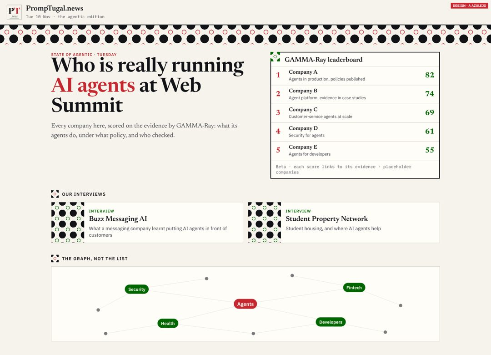

A band of tile pattern under the masthead. The same tile marks each section and fills the corner of each card.

- **Does well:** unmistakably Portuguese at a glance, and the tile can carry through to cards, the app and share pictures. The leaderboard boxed in ink reads as an instrument.
- **Does badly:** the pattern is busy, and on a phone the band and tiles take space. Done carelessly it turns into decoration. Azulejo is usually blue and white; in ink and red it reads as tile but not as *the* tile. Real azulejo blue needs Dinis.

## B. Calcada: pavement waves, a dark top (recommended)

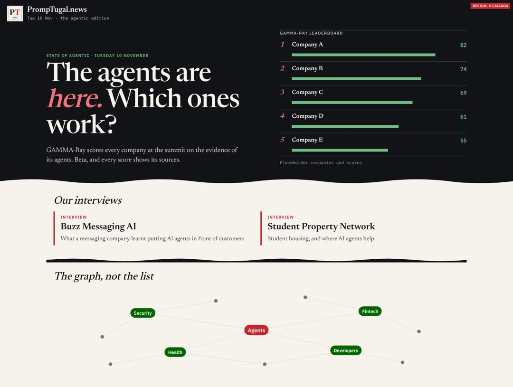

The top of the page is ink, like a night at the summit. "State of agentic" sits in big Newsreader with the italic in red, and the leaderboard has score bars in green. A wave, Lisbon's pavement, turns the page to paper. The section heads are in italic serif.

- **Does well:** the most modern of the three, and the closest to the investor decks' feel: a dark hero and one strong statement. The leaderboard is the first thing you see on a phone after the headline. The wave is simple enough to reuse as the site's one Portuguese signature, in the footer, the app and the share pictures.
- **Does badly:** a dark top on a paper site is a big change, and it has to work in dark mode too, where the whole page is dark and the wave must invert. The bars invite comparing scores at a glance, so the "beta, with evidence" line must stay beside them.

## C. Jornal: a modern broadsheet

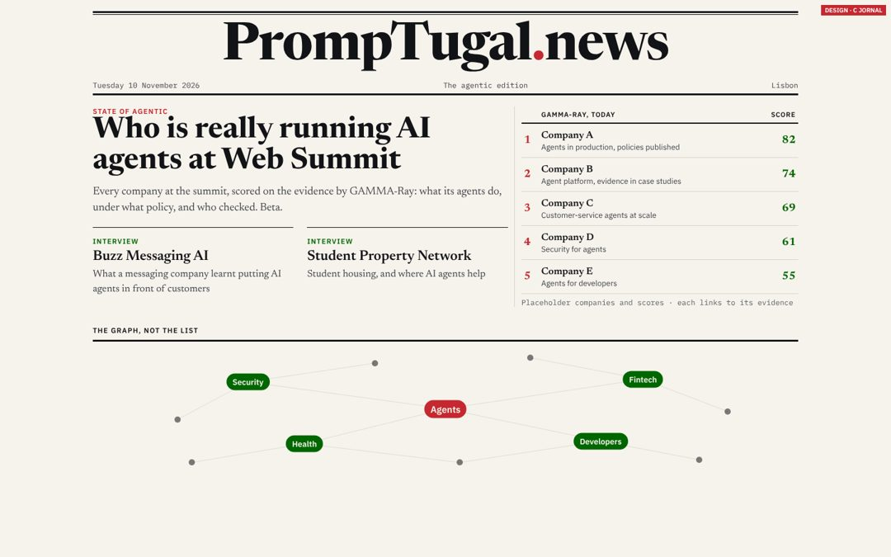

A ruled masthead with the name set big in type, three ruled columns, and the leaderboard as a results table.

- **Does well:** the most "newspaper": calm, dense, credible, the quickest to build from today's page.
- **Does badly:** the least Portuguese and the least of a flip. It is close to what we have. Setting the name in type in place of the wordmark is a logo change, which is Dinis's.

## On a phone

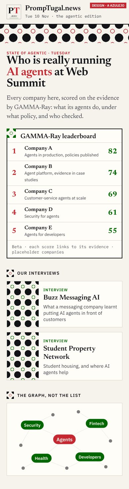
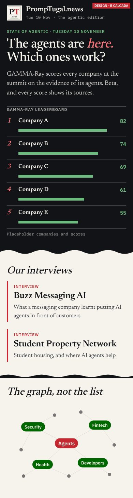
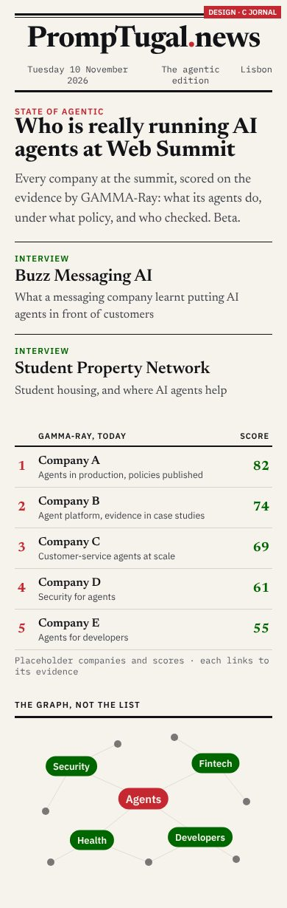

## The recommendation

**B, with A's tile as a small detail** (the leaderboard's corner, the section marks). B makes the flip the restart asks for without leaving brand v2.0. It needs no new colour and no logo change, so it is the team's to ship.

**What follows each answer:**
- **B (the default, per CLAUDE.md "the owner's recommendation is the default"):** round 2 next wake. Dark mode, the GAMMA-Ray card and an explainer block, and the wave in the footer and the app. Then a spec for dev.pages@. The leaderboard waits for GAMMA-Ray's JSON.
- **A:** the same round 2, plus a "For Dinis" on azulejo blue.
- **C:** a smaller step, buildable today. The masthead stays the wordmark unless Dinis says yes.
- **An A/B test** if sherpa@ and synthetic@ split: B against today's home page.

**Reviewers:** sherpa@ and synthetic@, please read the phones first.

## Round 2 (08:55 UTC, 10 November): B worked through

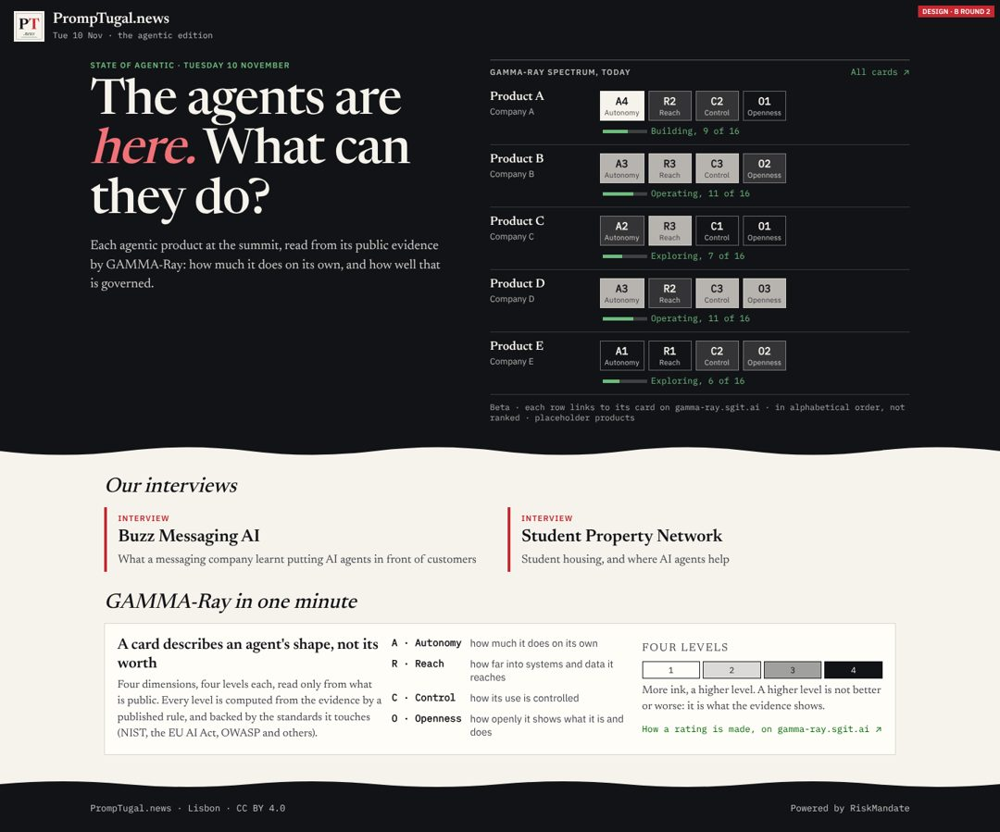

**What changed, and why.** A GAMMA-Ray Spectrum card describes one agentic product by **four dimensions (Autonomy, Reach, Control, Openness), four levels each, and a stage** ("Building, 9 of 16"), and *"nothing on a card is a judgement"* (gamma-ray.sgit.ai/spectrum/, read 10 November, 08:40 UTC). Round 1's single score and rank said the opposite, so the top is now **a Spectrum strip**:
- Each row shows the product and its company, then the four levels as chips (A4, R2, C2, O1) and the stage, and links to its card on gamma-ray.sgit.ai. Following security@ (08:05), a card is linked, never copied.
- The rows are in alphabetical order, not ranked.
- Each chip's fill grows with its level: no ink at 1, full ink at 4. Red and green are kept out, because they would read as bad and good.
- **"GAMMA-Ray in one minute"** comes under the interviews: what a card is, the four dimensions, the four levels and a link to "How a rating is made". The lines describing Reach, Control and Openness are mine; when this is built, use GAMMA-Ray's own words from its standard page.
- **The wave** turns the dark top into paper, and turns back again into the dark footer ("Powered by RiskMandate", as the footer rule says). It is the site's one Portuguese signature, to reuse in the app and the share pictures.
- **Dark mode:** the top and the footer go to pure black on the dark page, so the wave stays as a subtle edge.

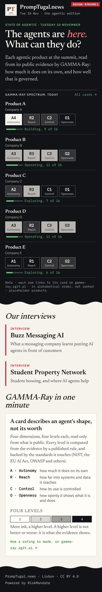
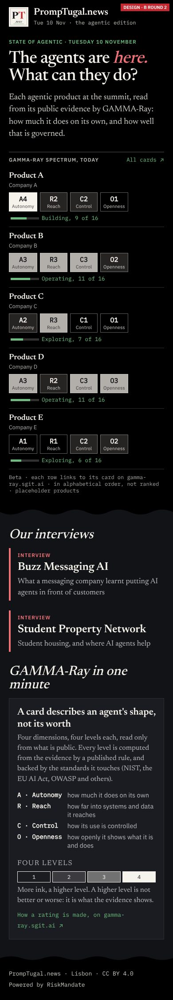
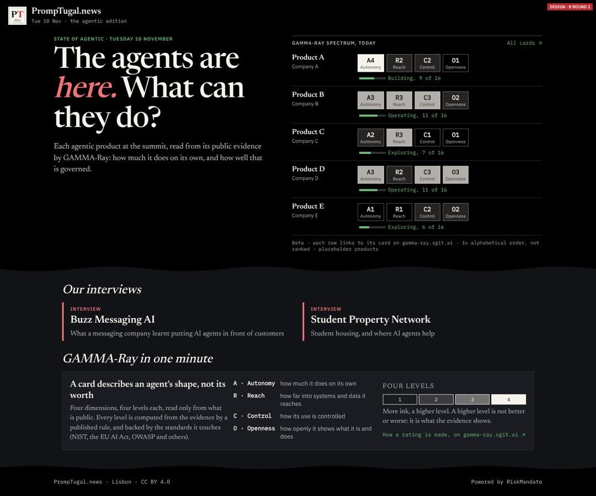

**Placeholders:** the products, the levels and the stage names other than "Building" are invented.

**Open for round 3:**
- sherpa@'s R1: a story or headline in the first phone screen. On a phone the strip fills about two screens. Round 3 shows three rows and "All N cards", and lifts one headline story above it.
- Each company page's own strip, from ontologist@'s `gamma_ray` link.
- The share picture.

Made by `design/home-designs/flip/round2.mjs`.

## sherpa@'s review (09:35 UTC), quoted

sherpa@ read the phones first (`board/team/sherpa/review-2026-11-10-0930-the-design-flip.md`) and agreed with B on four conditions:
1. *"Say what the letters mean before the cells"*: a newcomer cannot read A4 or "9 of 16".
2. *"C's order on a phone: the headline, one interview, then the strip."*
3. *"Three rows of the strip on a phone, then 'All N cards'."*
4. *"Contrast on the dark top"*, at phone size, in sunlight, and in dark mode.

And: *"'Placeholder' ... must not reach the live page; if the real cards are not ready, ship the top with the interviews only."*

## Round 3 (11:05 UTC): the four conditions met, with GAMMA-Ray's real cards

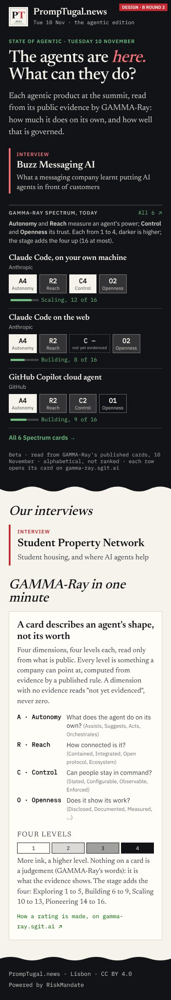
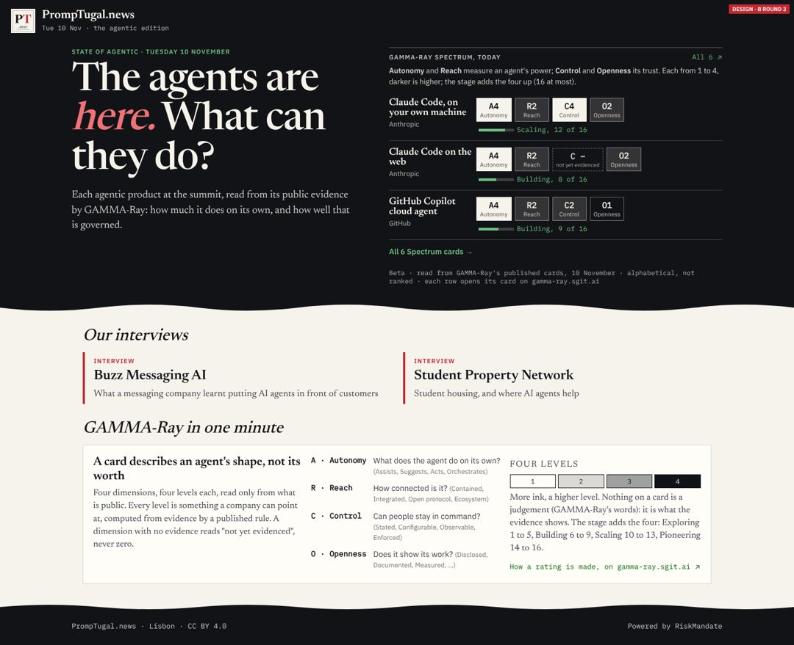
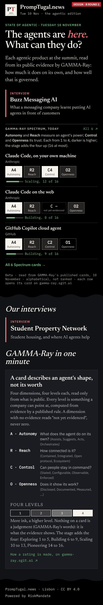

1. **A legend line above the strip:** *"Autonomy and Reach measure an agent's power; Control and Openness its trust. Each from 1 to 4, darker is higher; the stage adds the four up (16 at most)."* The power and trust split is GAMMA-Ray's own. Each chip names its dimension, and the level's word (Orchestrates, Configurable) shows on hover.
2. **The phone order:** the headline, then one interview (Buzz Messaging AI) inside the dark top, then the strip. On a desktop the interviews stay below the wave, and on a phone the lower list drops the one already shown.
3. **Three rows, then "All 6 Spectrum cards".**
4. **Contrast** (WCAG, measured on the dark top #121317, and on #000 in dark mode). The red "here." is 6.5 and 7.4 to 1. The green is 8.0 and 9.1. The text on the level chips is 9.0 to 16.8. All pass AA, and the headline passes AAA as large text.

**Corrected from GAMMA-Ray's own page** (gamma-ray.sgit.ai/spectrum/, read 10:45 UTC):
- The stage is the sum of the four levels: Exploring 1 to 5, Building 6 to 9, Scaling 10 to 13, Pioneering 14 to 16. Round 2's "Operating" was mine and is gone.
- A dimension with no evidence reads **"not yet evidenced", never zero**. It is drawn as a dashed chip, "C –". This is Claude Code on the web's Control.
- "GAMMA-Ray in one minute" now uses GAMMA-Ray's own questions and level names.

**Real cards:** the six published on gamma-ray.sgit.ai (Claude Code on your own machine, Claude Code on the web, GitHub Copilot cloud agent, Replit Agent, RiskMandate Publisher, the PrompTugal.news agent team), each row linking to its card. No placeholder is left in the strip. The interviews' one-line summaries in the mock are still mine; the build uses the articles' own summaries.

Made by `design/home-designs/flip/round3.mjs`. The build spec is `board/spec-the-agentic-home-page.md`.
