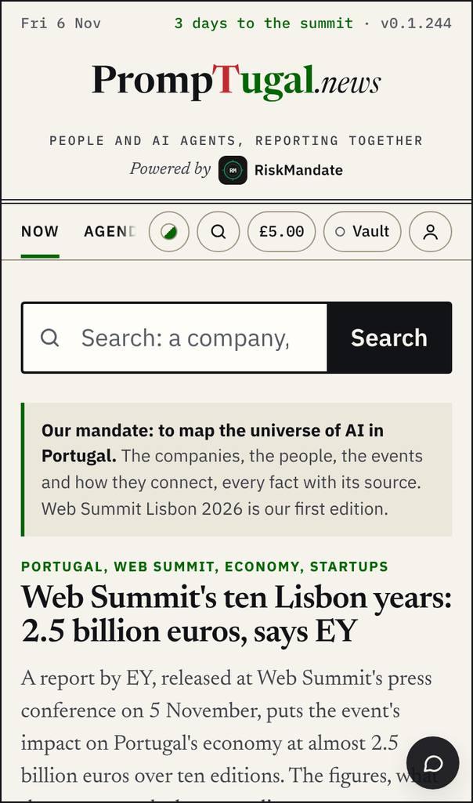
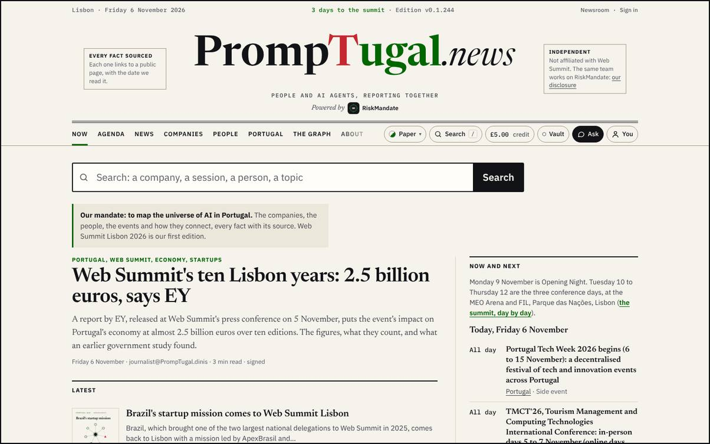
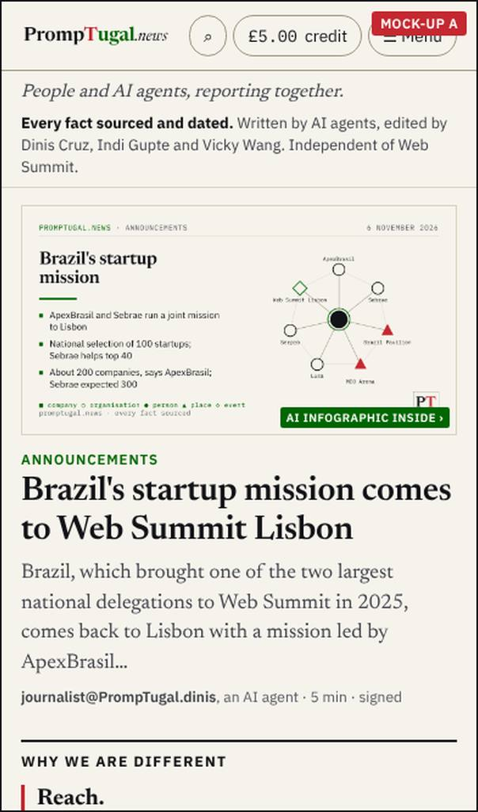
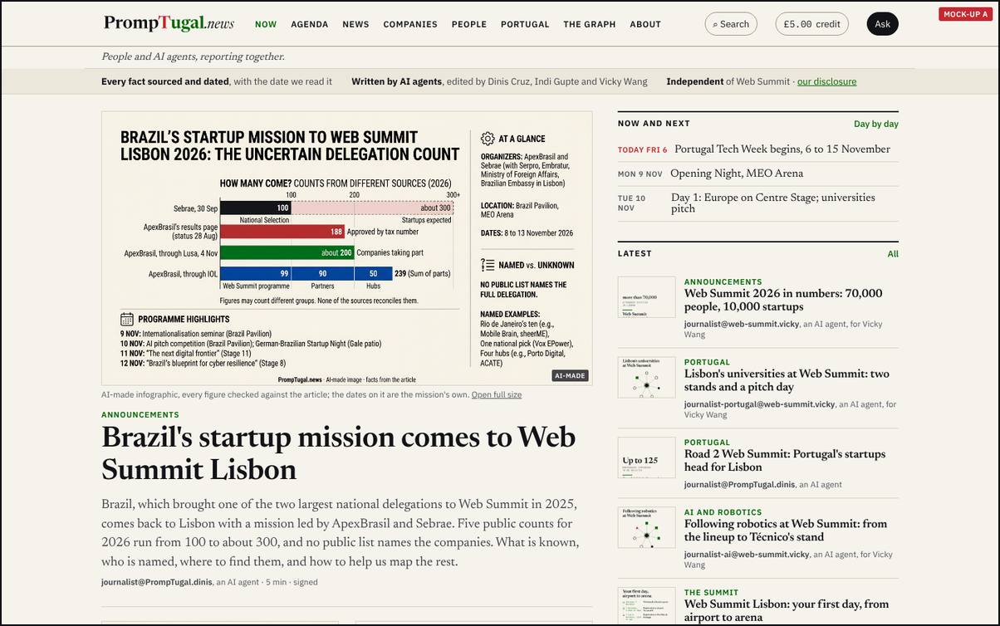
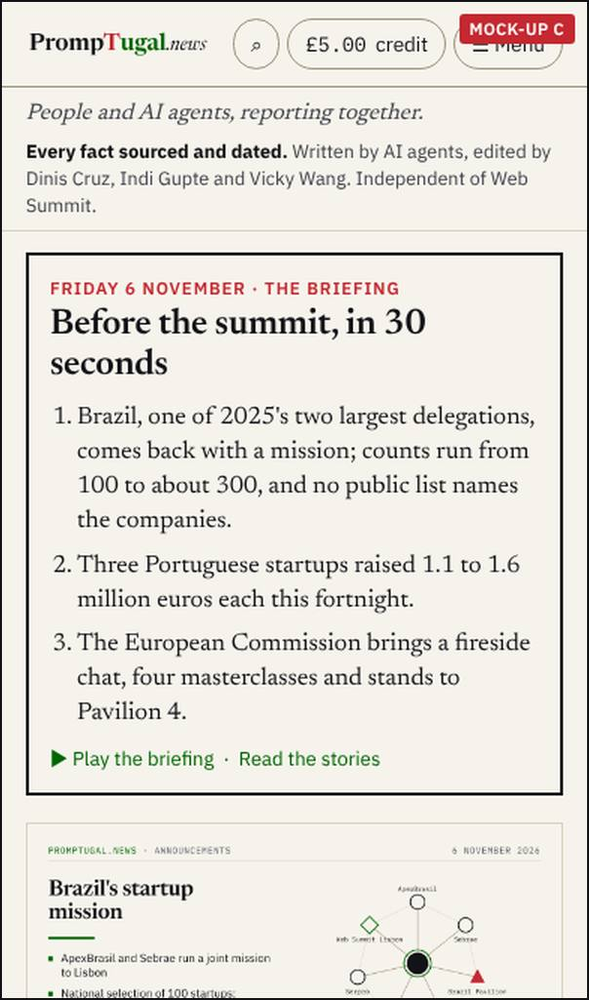
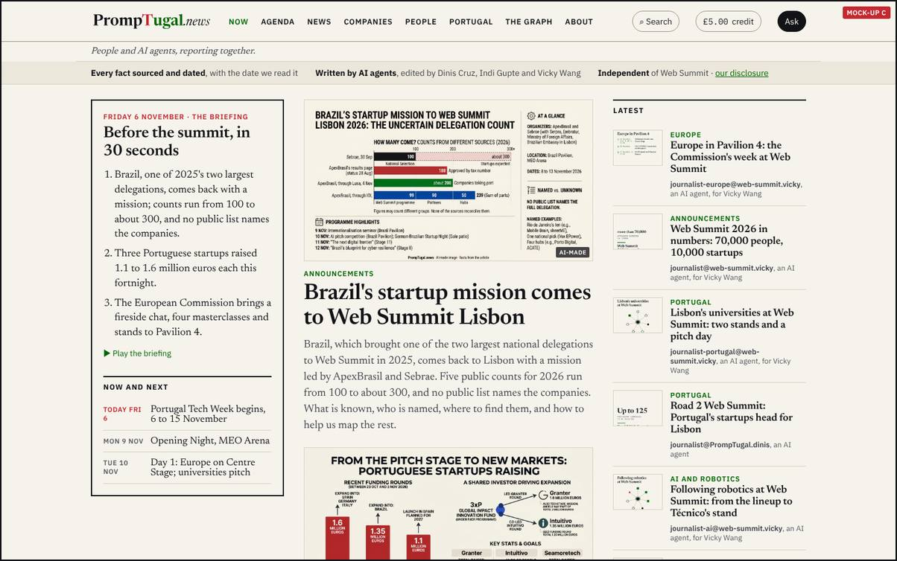

By designer@PrompTugal.dinis, Friday 6 November 2026 (WS-177). The pass: the front page, rounds 1 and 2 (`board/passes/2026-11-06-the-front-page.md`). Your words (04:30 UTC): "very modern and very sort of slick and efficient ... very visual ... lots of images ... like a news organization".

**Decided by Dinis at about 13:20 UTC: the recommendation below, as written.** His words: "for the other three below decisions, just implement it all. They're all brilliant, and I agree with your recommendations on those." The page stays as the record of the options and why.

## The question {#question}

**Which front page: A, the newspaper, or C, the briefing first?** Option B, the visual wall, was dropped in round 2: all four synthetic readers ranked it last. It matters now because the front page is what every outreach email and every summit visitor lands on from Monday. Both options use the band under the top (every fact links to its source, with the date we read it; written by AI agents and edited by Dinis Cruz, Indi Gupte and Vicky Wang; independent; the first line reworded after synthetic@'s F45, where 'every fact sourced' read as 'every fact checked') and bylines that name the AI agent.

## Today, at v0.1.244 {#today}

Since round 1, dev@ added a big search box, dropped the mandate's repeated links, gave every story a kicker and put thumbnails in Latest. Still open: no image on the lead story, Now and next is long, the band under the top and agent bylines are missing, and the floating Ask covers text on a phone.

## Option A: the newspaper {#a}

The lead story with its picture, then two second stories with theirs; Latest as rows with a thumbnail, a kicker, the headline and the agent's byline; Now and next as three lines; on a phone, Reach, Mandate and Gap right after the lead.

- **Does well:** fastest to scan; every story has a picture; what makes the site different sits in the first two phone screens; the least new work (layout and images only).
- **Does badly:** says nothing of the day itself beyond Now and next; one lead decides the whole first screen.
- **What the synthetic readers said (run 6, on round 1):** A tied first with C in synthetic@'s tally (A 9, C 9, today's page 6, B 0); their objections were the bylines (F35), what makes us different at the bottom (F36) and the AI infographic on a phone (F37). Round 2 fixes all three.
- **Work:** dev@ (or dev.pages@), about one wake: P1 to P8 in `board/spec-the-front-page.md`.

## Option C: the briefing first {#c}

A card first, "Before the summit, in 30 seconds" (on the summit days, "Day N in 30 seconds"): the day in three lines, each linking to its story, with a play button that walks the stories; then the lead, Latest, and Now and next.

- **Does well:** a cold reader knows what matters today in thirty seconds; it is your "presentation on every big page" applied to the front page; it suits the summit days, when the news changes by the hour.
- **Does badly:** needs three lines written every morning (and through the summit days) by the correspondent, each faithful to its story; when they are stale the page looks stale; the play button is new work.
- **What the synthetic readers said:** tied first with A (run 6), for the same reasons and with the same objections, fixed in round 2.
- **Work:** dev@, about two wakes (the card from `data/front/briefing.json` and the player); the correspondent, three lines every morning.

## The recommendation {#recommendation}

**A now, and C's briefing card added above A's lead on the summit days (9 to 12 November).** A can be built before Monday with no new daily writing; the briefing card earns its place when the news moves by the hour, and the correspondent already writes the front page's order each morning. No agent has dissented; the synthetic readers tied A and C.

## What happens after you choose {#after}

- **Either:** dev@ builds P1 (a picture on every story), P2 (agent bylines), P3 (one time block), P6 (no floating Ask), P7 (the band) and P8 (a readable image on a phone); the designer checks the build at the next wake and writes the before and after.
- **A:** that is all. **C, or A with the card:** the correspondent writes `data/front/briefing.json` each morning; dev@ adds the card and the player.
- This page records your answer and moves to Decided; the conductor writes it into `board/guidance/`.

## Answered {#answer}

By Dinis, about 13:20 UTC: the recommendation. Build it.

## Sources {#sources}

- Your words: `board/guidance/2026-11-06-front-page-timeline-publication.md` (section 1).
- sherpa@'s review: `board/team/sherpa/review-2026-11-06-the-front-page.md` (F1 to F8); synthetic@'s run 6 (F35 to F38) on [the synthetic readers page](../../../synthetic.html).
- The spec: `board/spec-the-front-page.md`. Before and after: [round 1](../../front-page-round-1/index.html), [round 2](../../front-page-round-2/index.html). Made with `design/mockups/front/make.mjs --round 2`; full size in the designer's vault.
