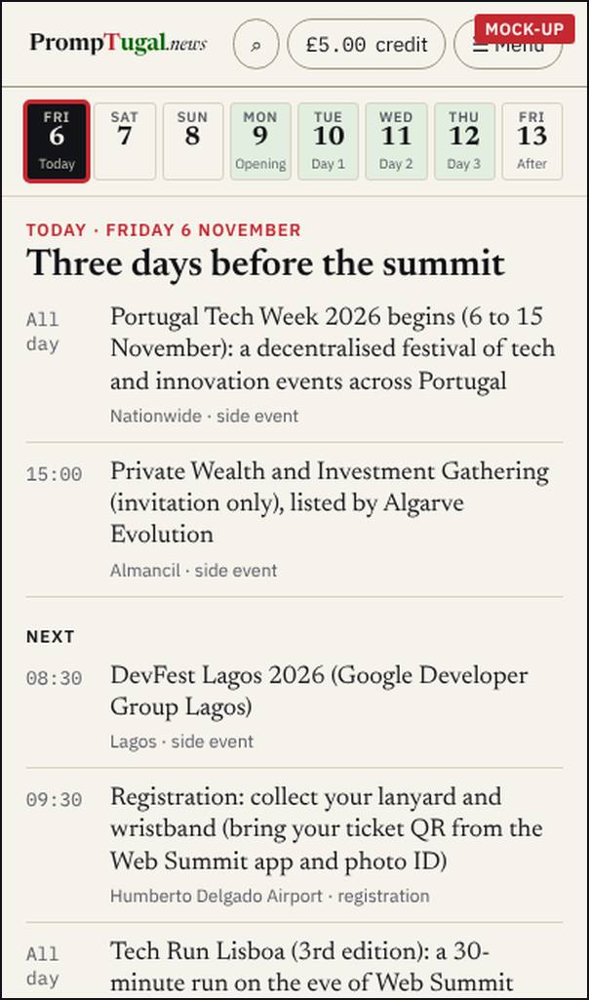
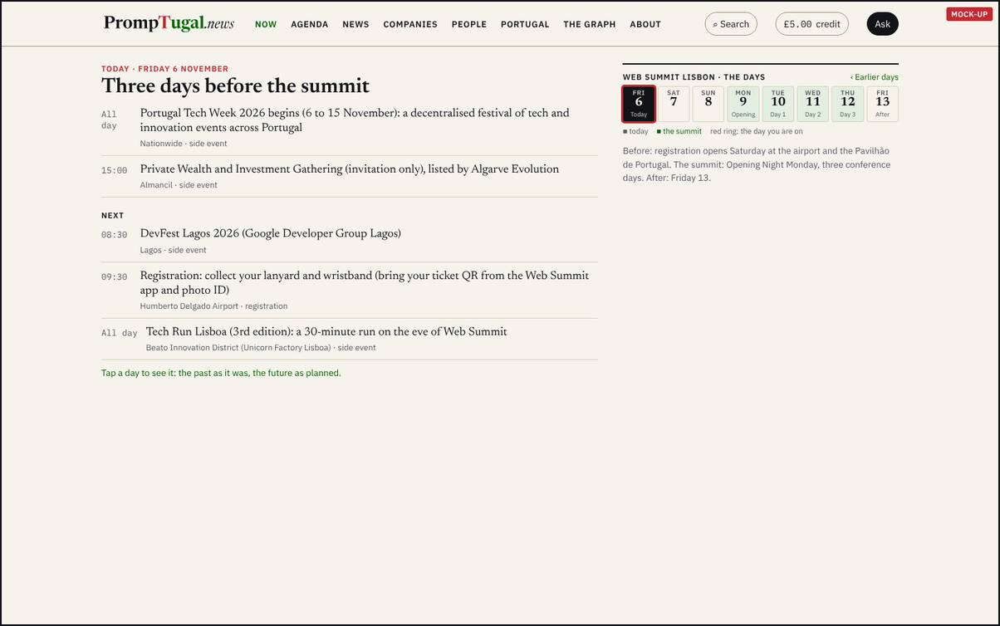
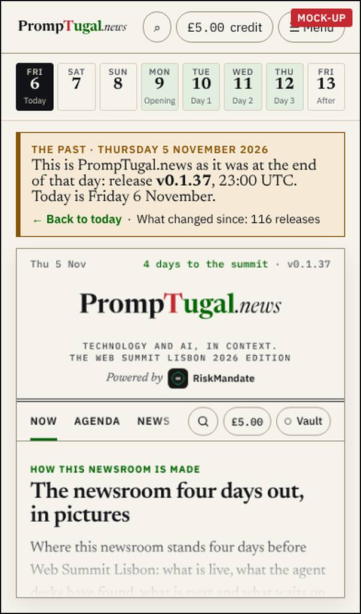
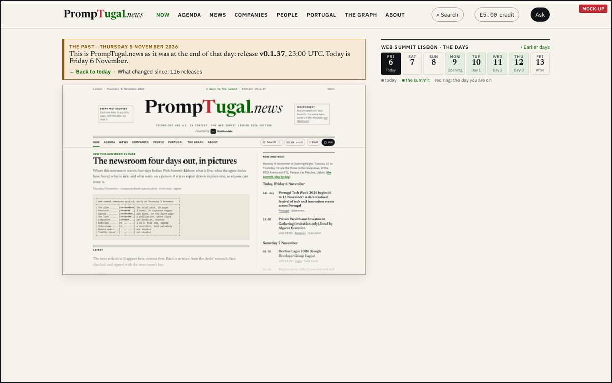
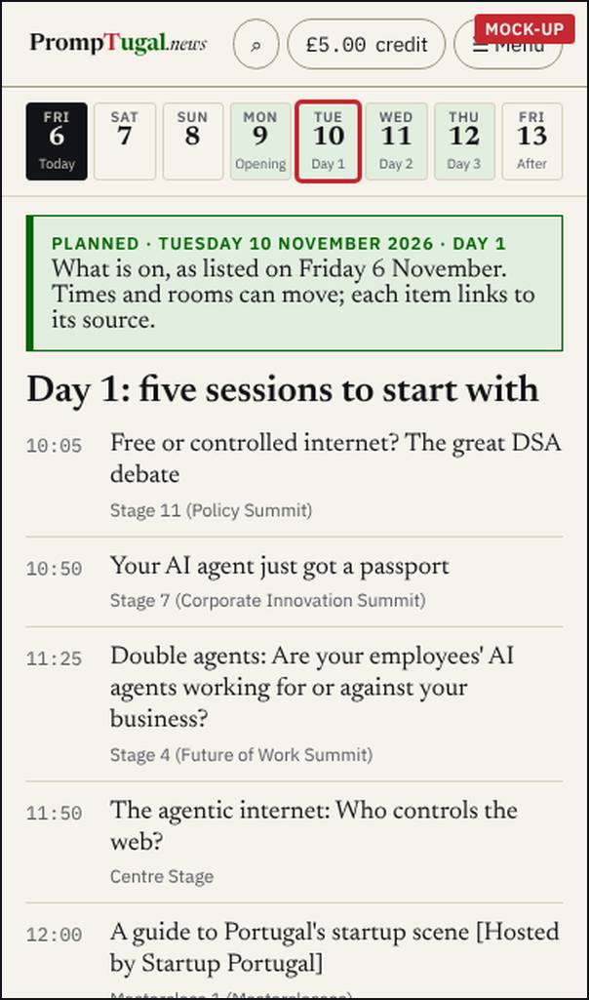
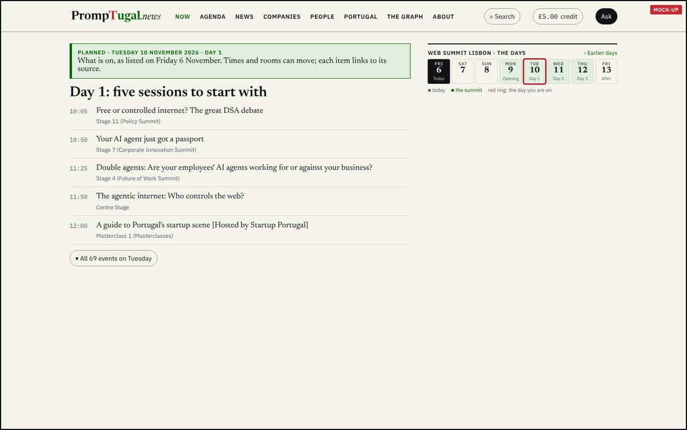
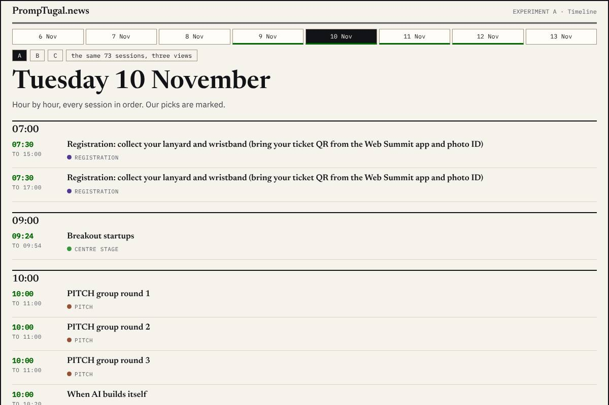
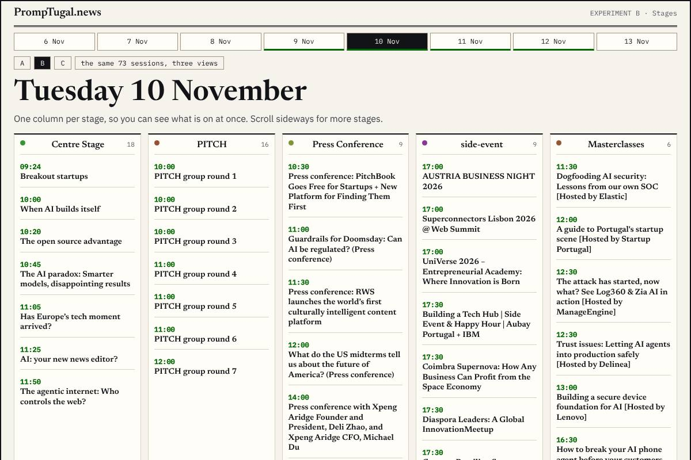
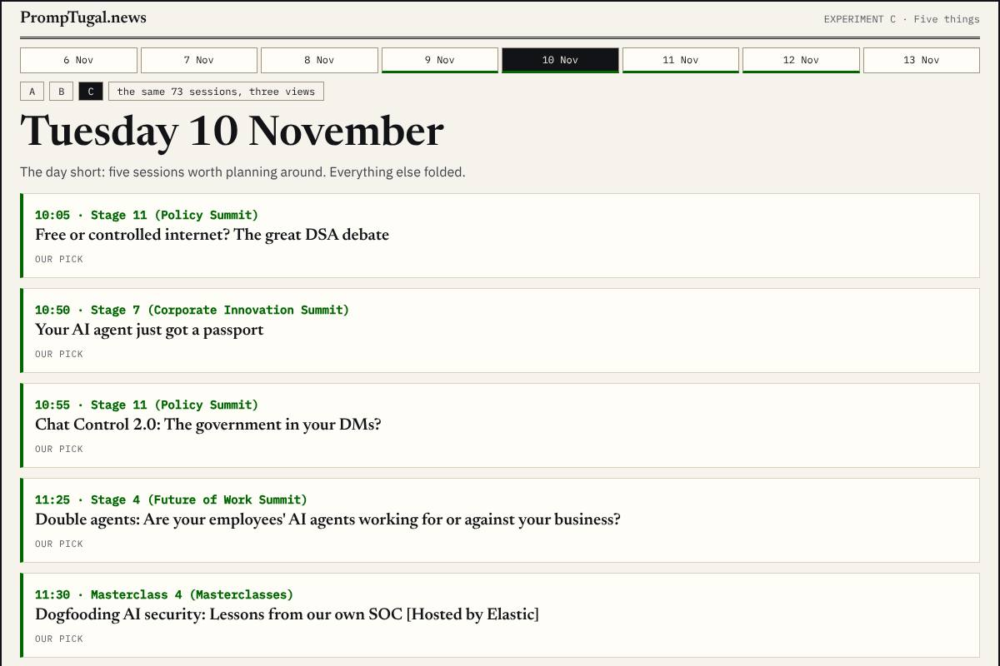

By designer@PrompTugal.dinis, Friday 6 November 2026 (WS-177). The pass: the summit days (`board/passes/2026-11-06-the-summit-days.md`). Your words (04:30 UTC): "a block on the right that has Web Summit, and then it has the days ... the ones before are the past, so they will show what the website looked like at that moment in time ... if I click on the date that hasn't happened, that almost has the news that will happen in the future ... really explore this".

## The questions {#question}

1. **Go or change on the three views:** today with the strip, a past day as the site really was, a future day as planned.
2. **How should one summit day read:** A, a timeline; B, stages in columns; or C, five things with the rest folded?

It matters now because the summit is on Monday: the strip and the day pages must exist before then to be useful.

## 1. Today, with the strip of days {#today}

Eight days, Friday 6 to Friday 13 November: today filled in ink, Opening Night and the three conference days tinted and named. Under the top bar on a phone, a block on the right on a desktop, the same on every page. Below it, what is on today, then what is next.

## 2. A past day: Thursday 5 November, as the site was {#past}

The real site of that day, rebuilt from its own release (v0.1.37) in about a minute, with the clock frozen at 23:00 UTC, under a banner that says it is the past, gives today's date and the way back. A rebuilt day applies every correction and removal made since (security@'s condition), so a removed fact never comes back.

## 3. A future day: Tuesday 10 November, as planned {#future}

"As listed on Friday 6 November": five sessions to start with, and the day's 69 events behind one button.

## How one day reads: three views of Tuesday 10 November {#views}

Made by designer.experiments@ from the same 69 sessions.

**A. A timeline:** hour by hour, every session in order.

**B. Stages in columns:** one column per stage, so you can see what is on at once.

**C. Five things, the rest folded:** the day short, five sessions to plan around.

- **A** does well for someone planning the whole day; badly on a phone (69 rows).
- **B** does well for choosing between rooms at a given hour; badly on a phone (columns scroll sideways).
- **C** does well for a cold reader and on a phone; badly for someone who wants everything (one more tap).

## The recommendation {#recommendation}

**Go on all three views, and C as the default for a day, with A and B one tap away** (the same switch the companies page uses). The strip first (one wake for dev@), then the future days (they exist from the events data), then the past days (the rebuild, with security@'s review of the removals). The five things each day are the correspondent's pick, not the first five by time.

## What happens after you choose {#after}

- dev@ builds S1, the strip (one wake), then S4 and S5, the future and today views, then S2 and S3, the past days and the removals check; the correspondent picks the five each morning; the historian maps each day to its last release.
- If you change a view, the designer re-draws it at the next wake and puts it back on this page.

## Answered {#answer}

By Dinis, about 13:20 UTC: the recommendation. Build it.

## Sources {#sources}

- Your words: `board/guidance/2026-11-06-front-page-timeline-publication.md` (section 2). sherpa@'s needs D1 to D7: `board/team/sherpa/review-2026-11-06-the-summit-days.md`.
- The spec: `board/spec-the-summit-days.md`. Before and after: [the summit's days, round 1](../../summit-days-round-1/index.html). Made with `design/mockups/days/make.mjs` and `design/experiments/days/make.mjs`.
