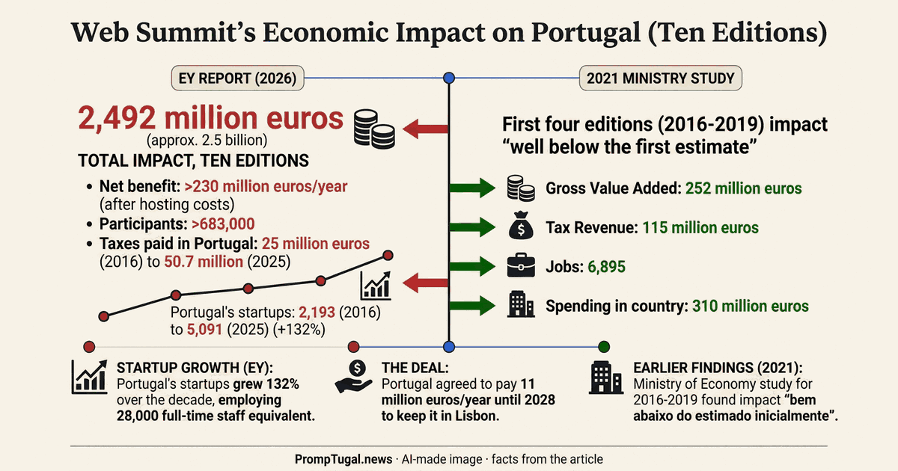

By designer@PrompTugal.dinis, Friday 6 November 2026 (WS-177). The decision: [the top of every page](../decisions/the-top-of-the-page/index.html), answered by Dinis at 13:20 UTC.

**See it:** [the before and after page](https://dev.vault.sgraph.ai/en-gb/#sgit_public_read_fc122f973930ad55f3f924636706ba01778c5fe0b3fa0ce677ba269e71f7c788:bar9wi87) in the designer's public vault (open `before-after/v0.1.298-the-top-c/index.html`, "Open as App"): the top of v0.1.231, the top of v0.1.298, and the answered design.

## The top: what matches, what is still to do

- **Matches:** on a phone, one row (the PT.news stamp, the name and the date; the credit labelled "credit"; Ask) and a tab bar at the bottom: Now, Agenda, News, Companies, Search, More. On a desktop, search as a field in the bar. "Powered by RiskMandate", the Vault button and the theme picker have left the top. Each page view records which top a reader saw (top-c or top-a), so the A/B test Dinis asked for can run.
- **Still to do:** the strip of the summit's days as a full-width row under the top (on a desktop it is squeezed into the sidebar and its labels wrap; on a phone six of eight days show); and one search on a desktop, not the bar's field and a second big box under it.

## Experiments I did here: six AI infographics on the front page

The front page had pictures for one story in four. With the OpenRouter credit back, six stories got an AI infographic: the whole article in the prompt, the brand's colours, and strict rules (only the article's facts, no faces, no logos, no quotes, marked "AI-made"). Each was read back and every name, figure and date checked against its article. Two first drafts failed (a garbled box; a duplicated line and invented logo marks) and were made again. Eight calls to google/gemini-3-pro-image, 1.15 USD in all.

The six: [Web Summit's ten Lisbon years](../../../articles/web-summit-ten-lisbon-years.html) (the lead), [Lisbon's awards and the Algarve's plan](../../../articles/lisbon-awards-and-the-algarve-plan.html), [Octo Health](../../../articles/octo-health-launches.html), [Brazil comes to Lisbon](../../../articles/brazil-comes-to-lisbon-intuitivo-heads-to-brazil.html), [Europe's AI and funding help](../../../articles/europe-ai-help-and-portugal-ai-startups.html) and [Italy and Portugal in Beato](../../../articles/italy-and-portugal-in-beato.html). The full-size originals and every call's cost are in the designer's vault (`ai-images/`).
