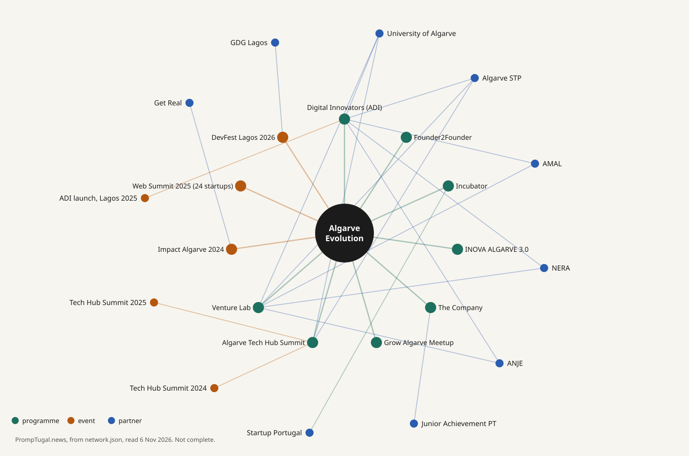

::: ae
::: ae-hero
**Diversify the Algarve's economy beyond tourism: help 500 companies, create 150 startups and reach 50,000 people by 2032.**

That is the mandate of Algarve Evolution, the Faro-based association that has connected the region's entrepreneurs, talent, startups, SMEs and partners since 2018. This page gathers, in one place, who they are, what they run, who they work with and how they have met the world around Web Summit. Every fact has its public source and the date we read it (6 November 2026); figures marked self-reported are theirs, as reported, and we have not verified them. This page is meant to be corrected and added to by the people it is about: see the last section.

[Jump to the interactive network, timeline and map](../../graph/algarve-evolution/index.md)

{.ae-label}
So far, as reported

{.ae-tiles}
- **2018** began *a small group of local entrepreneurs*
- **118** active members *self-reported, 1 November 2026*
- **142+** events in 2024 and 2025 *self-reported*
- **5,597** participants at them *self-reported*
- **24** Algarve startups to Web Summit 2025 *partner and jury seat*

{.ae-label}
Goals for 2032: targets, not results

{.ae-tiles}
- **500** companies to support *target*
- **150** startups to help create *target*
- **50,000** people to impact *target*

> These are ambitious goals, and we know we can only achieve them by working together with our partners and the wider innovation ecosystem.

Algarve Evolution's own words, from António Pinto Guerreiro, 6 November 2026.
:::

::: ae-sec
## Who they are {#who}

Algarve Evolution is a Faro-based organisation that connects entrepreneurs, talent, startups, SMEs and partners to build an innovation ecosystem in the Algarve. It began in 2018, when a small group of local entrepreneurs started building the region's innovation community ([Portugal Startup News, 1 November 2026](https://portugalstartupnews.com/2026/11/01/algarve-evolution-aims-to-support-500-companies-and-help-create-150-startups-by-2032-in-push-beyond-tourism/), read 6 November 2026). Its own site describes the aim as helping them "co-create a vibrant innovation ecosystem in the Algarve region" ([algarveevolution.pt](https://www.algarveevolution.pt), read 6 November 2026). The organisation is in our [data as an organisation](../../organisations/algarve-evolution/index.md).
:::

::: ae-sec
## The mandate {#mandate}

To diversify the Algarve's economy beyond tourism and help established industries become more competitive. Its executive director describes the 2026 shift as from building a community to making the ecosystem work ([Portugal Startup News](https://portugalstartupnews.com/2026/11/01/algarve-evolution-aims-to-support-500-companies-and-help-create-150-startups-by-2032-in-push-beyond-tourism/), read 6 November 2026). Its website states three pillars: education, startups and SMEs, and the innovation ecosystem ([algarveevolution.pt](https://www.algarveevolution.pt), read 6 November 2026).

**Targets for 2032** (as reported on 1 November 2026): support 500 companies, help create 150 startups, impact 50,000 people.

> These are ambitious goals, and we know we can only achieve them by working together with our partners and the wider innovation ecosystem.

Algarve Evolution's own words, from António Pinto Guerreiro, 6 November 2026.
:::

::: ae-sec
## Their story in time {#timeline}

{.ae-timeline}
- **2018** A small group of local entrepreneurs starts building the Algarve's innovation community ([Portugal Startup News](https://portugalstartupnews.com/2026/11/01/algarve-evolution-aims-to-support-500-companies-and-help-create-150-startups-by-2032-in-push-beyond-tourism/)).
- **12 September 2019** Officially presented in Faro, on the terrace of the Centro Ciência Viva do Algarve, as a non-profit association of about 29 ICT companies. Its stated aims included building critical mass, mapping regional skills, internationalising, speaking with one voice at events such as Web Summit, keeping graduates in the region and diversifying beyond tourism ([Barlavento, 20 September 2019](https://www.barlavento.pt/mais/algarve-evolution-vai-promover-empresas-de-vanguarda-tecnologica); [postal.pt, 14 September 2019](https://postal.pt/nacional/empresas-juntam-se-para-fazer-do-algarve-um-destino-mais-tecnologico-e-competitivo/)).
- **June 2023** The Algarve Innovation Hub publishes its internationalisation strategic plan (same source).
- **1 June 2024** Impact Algarve, organised with the non-profit Get Real at the University of Algarve's UAlg Tec Campus, gathers the region's local players ([postal.pt, 6 June 2024](https://postal.pt/algarve/impact-algarve-juntou-principais-intervenientes-locais-para-debaterem-o-futuro-da-regiao/)).
- **July 2024** A new president is elected to lead the association for 2024 to 2027 ([postal.pt, 11 July 2024](https://postal.pt/economia/joaquim-nascimento-e-o-novo-presidente-da-algarve-evolution/)).
- **September 2025** The Algarve Digital Innovators network is launched in Lagos ([postal.pt](https://postal.pt/algarve/lagos-lanca-rede-algarve-digital-innovators-para-impulsionar-inovacao-e-startups/)).
- **November 2025** Project partner and jury member in the competition that takes 24 Algarve startups to Web Summit Lisbon ([ANJE regulation](https://anje.pt/wp-content/uploads/Regulamento-Participacao-Startups-Websummit-2025_01_09_2025_Paginado-versao-EN.pdf)); the Informa D&B startup study is presented; the Algarve Tech Hub Summit in Lagos reports more than 500 participants ([postal.pt](https://postal.pt/algarve/mais-de-500-pessoas-participaram-na-algarve-tech-hub-summit-2025-em-lagos/)).
- **January 2026** Its incubator is recognised by Startup Portugal ([Portugal Startup News](https://portugalstartupnews.com/2026/11/01/algarve-evolution-aims-to-support-500-companies-and-help-create-150-startups-by-2032-in-push-beyond-tourism/)).
- **July 2026** The ADI 2030 development plan is published (same source).
- **October 2026** Founder2Founder, a six-month growth programme, is launched (same source).
- **6 to 7 November 2026** Events on its calendar in the Algarve in the first days of Portugal Tech Week: DevFest Lagos, where it is a partner, among them (below).
- **2027** The Algarve Tech Hub Summit is confirmed to return, with no date or venue announced; an early-stage incubation programme is planned (same source).
:::

::: ae-sec
## Programmes {#programmes}

{.ae-cards}
- **Algarve Digital Innovators (ADI)**, a network of innovation communities across the Algarve's 16 municipalities, launched in Lagos in September 2025 ([postal.pt](https://postal.pt/algarve/lagos-lanca-rede-algarve-digital-innovators-para-impulsionar-inovacao-e-startups/)), under the Algarve EMPREENDE 2026 project. Its July 2026 plan counts 24 communities and 144 consultants and mentors, and sets goals for 2030 that depend on funding and regional coordination.
- **Education**: work with the University of Algarve, Junior Achievement Portugal ("The Company") and Vibathon Algarve.
- **Algarve Evolution Incubator**: recognised by Startup Portugal in January 2026.
- **Founder2Founder**: a six-month growth programme launched in October 2026; 8 companies chosen from 41 applications; no equity taken (its own site, read 6 November 2026, says applications are closed and the cohort will be announced). An early-stage incubation programme is planned for 2027.
- **INOVA ALGARVE 3.0**: digital transition for tourism SMEs, with a pilot of free AI and robotics consultancy for 20 SMEs.
- **Algarve Tech Hub Summit**: co-organised with the University of Algarve and Algarve STP, according to Portugal Startup News. The 2025 edition in Lagos (6 to 7 November 2025) reported more than 500 participants ([postal.pt](https://postal.pt/algarve/mais-de-500-pessoas-participaram-na-algarve-tech-hub-summit-2025-em-lagos/), headline read 6 November 2026); it is confirmed to return in 2027, with no date or venue announced.
- **Grow Algarve Meetup**: its Meetup page names Algarve Evolution as organiser; 1,623 members and monthly gatherings across Algarve municipalities, none listed as upcoming on 6 November 2026 ([Meetup](https://www.meetup.com/grow-algarve-meetup/), read 6 November 2026).
- **Venture Lab by AlgarveSTP**: Algarve Evolution is one of six partners; 12 startups and SMEs selected for mentoring (published 10 July 2026). Its specific role is not described ([postal.pt](https://postal.pt/algarve/venture-lab-by-algarvestp-seleciona-12-empresas-para-acelerar-crescimento/), read 6 November 2026).
- **Innovation and Collaboration Platform for Digitalization**: sessions towards a Regional Collaborative Plan, with governance recommendations for CCDR-Algarve.

Sources: [Portugal Startup News](https://portugalstartupnews.com/2026/11/01/algarve-evolution-aims-to-support-500-companies-and-help-create-150-startups-by-2032-in-push-beyond-tourism/) and [algarveevolution.pt](https://www.algarveevolution.pt), both read 6 November 2026.
:::

::: ae-sec
## In numbers (self-reported) {#numbers}

{.facts}
| | |
|---|---|
| **Members** | 118 active members, with about 100 million euros combined annual turnover and about 1,000 direct jobs. These describe the members, not Algarve Evolution. |
| **Activity** | More than 142 events in 2024 and 2025, with 5,597 participants. |
| **The region** | An Informa D&B study (presented November 2025) found 115 startups in the Algarve in 2024, up 16%, 95% of them microenterprises. |

Source: [Portugal Startup News](https://portugalstartupnews.com/2026/11/01/algarve-evolution-aims-to-support-500-companies-and-help-create-150-startups-by-2032-in-push-beyond-tourism/), read 6 November 2026.

**Members over time, as reported (not like for like):** about 29 companies at the 2019 presentation ([Barlavento](https://www.barlavento.pt/mais/algarve-evolution-vai-promover-empresas-de-vanguarda-tecnologica)), about 70 companies and individuals in July 2024 ([postal.pt](https://postal.pt/economia/joaquim-nascimento-e-o-novo-presidente-da-algarve-evolution/)), 118 active members in November 2026 (Portugal Startup News). The Grow Algarve Meetup counts 1,623 members on [Meetup](https://www.meetup.com/grow-algarve-meetup/).
:::

::: ae-sec
## Partners named {#partners}

University of Algarve, Algarve STP, AMAL, NERA, ANJE, Junior Achievement Portugal, Startup Portugal and CCDR-Algarve (sources above). Informa D&B is not a partner: it wrote the startup study the press cites.

**[Explore it: the interactive network, timeline and map of Algarve Evolution](../../graph/algarve-evolution/index.md)**, each node, event and place with its source, each picture saved as a PNG.

**The regional bodies, read on their own sites (6 November 2026):** [AMAL](https://www.amal.pt), the Algarve intermunicipal community, lists 16 member municipalities, which is the 16 of the Algarve Digital Innovators network: Albufeira, Alcoutim, Aljezur, Castro Marim, Faro, Lagoa, Lagos, Loulé, Monchique, Olhão, Portimão, São Brás de Alportel, Silves, Tavira, Vila do Bispo and Vila Real de Santo António. [NERA](https://www.nera.pt), the business association of the Algarve region, says "35 years serving the region's businesses" and lists business support, legal advice, training and a business centre. [ANJE](https://www.anje.pt/en) represents young Portuguese entrepreneurs and runs an incubation network. For the rest, see [the partner organisations](../organisations/index.md).
:::

::: ae-sec
## Web Summit before: 2025 {#websummit}

The regulation of the competition "Participation of Algarve Startups in Web Summit Lisbon 2025" names the Algarve Evolution Association as a project partner, with the University of Algarve (lead promoter), AMAL, Algarve STP and NERA. It promoted the participation of 24 Algarve startups at Web Summit Lisbon, 10 to 13 November 2025, and Algarve Evolution held one of the five permanent jury seats ([ANJE, regulation PDF](https://anje.pt/wp-content/uploads/Regulamento-Participacao-Startups-Websummit-2025_01_09_2025_Paginado-versao-EN.pdf), read 6 November 2026; also [Portugal Resident](https://stg.portugalresident.com/algarve-to-be-represented-by-24-startups-at-web-summit-2025/)). For 2026 we have found no confirmed Algarve Evolution presence at Web Summit Lisbon or event of its own in summit week: that is a question for the meeting.
:::

::: ae-sec
## Their November in 2025 {#november}

Two community events show how the Algarve scene fills the weeks around Web Summit and Portugal Tech Week. Both are past, and both pages are on Luma, read 6 November 2026.

{.ae-cards}
- **Algarve Tech Afterwork**, Tavira: Algarve Evolution is listed among the organisers with 351 Startup Association, LOFT Community, Local Foundation and Tavira Works, "in collaboration with Portugal Tech Week". The page shows no date; registration is closed ([Luma](https://luma.com/futhhudo)).
- **Algarve Tech 2025 Wrap Party**, Faro: organised by LOFT Agenda and presented with FlourishMode and Algarve Evolution. It recaps a November series named on the page: Algarve Buildathon, GDG DevFest, Startup Weekend Lagos, Web Summit, Portugal Tech Week and the Algarve Tech Hub Summit ([Luma](https://luma.com/ydjwl98z)).

We found no equivalent 2026 listing yet. We also found no public member list, so we cannot yet say which members are companies we follow.
:::

::: ae-sec
## The Algarve in summit week {#events}

Three events in our programme appear on Algarve Evolution's events calendar. Only one names it as a partner; the other two are organised by others and are listed there. Each was read at its own page on algarveevolution.pt on 6 November 2026.

{.ae-cards}
- [DevFest Lagos 2026](../../events/devfest-lagos-2026/index.md), 7 November, Lagos. Organised by Google Developer Group Lagos; partners Câmara Municipal de Lagos, Google Developer Groups and **Algarve Evolution** ([page](https://www.algarveevolution.pt/event/gdg-lagos-182/register)).
- [TMCT'26, Tourism Management and Computing Technologies International Conference](../../events/tmct-26-tourism-management-and-computing/index.md), in-person days 5 to 7 November, Portimão. Organised by Associação Académica do ISMAT / Grupo Lusófona; no partners listed for the event ([page](https://www.algarveevolution.pt/event/tourism-management-computing-technologies-international-conference-149/register)).
- [Private Wealth and Investment Gathering](../../events/private-wealth-and-investment-gathering/index.md), 6 November, Almancil, invitation only. Organised by Sotavento Invest; listed on the calendar, not run by Algarve Evolution ([page](https://www.algarveevolution.pt/event/private-wealth-investment-gathering-180/register)).

The wider week: [Portugal Tech Week](../index.md), 6 to 15 November, across the country.
:::

::: ae-sec
## The people {#people}

- **António Guerreiro, executive director.** Named in that role by [postal.pt on 6 June 2024](https://postal.pt/algarve/impact-algarve-juntou-principais-intervenientes-locais-para-debaterem-o-futuro-da-regiao/) and by [Portugal Startup News on 1 November 2026](https://portugalstartupnews.com/2026/11/01/algarve-evolution-aims-to-support-500-companies-and-help-create-150-startups-by-2032-in-push-beyond-tourism/), where he describes the 2026 shift from building a community to making the ecosystem work. He also presented the Algarve Digital Innovators network at its launch in Lagos ([postal.pt, 11 September 2025](https://postal.pt/algarve/lagos-lanca-rede-algarve-digital-innovators-para-impulsionar-inovacao-e-startups/)).

The association's presidency changed hands in July 2024, for 2024 to 2027 (timeline above). Its own website lists no leadership, so we name no one else here; we have asked nobody else, and a person is named only with a public professional role and its source. We list a person only for a public professional role, with the source.
:::

::: ae-sec
## Correct us, add to us {#correct}

Open: its own site was unreachable for part of our research, so leadership, the member list and its summit-week plans are not yet confirmed first-hand. The 2022 start of the Tech Hub Summit (Portugal Startup News) and the 2024 article calling 2024 its second edition do not obviously agree; we have not resolved that. The Algarve Tech Hub platform's own events calendar ([algarvetechhub.com](https://www.algarvetechhub.com/engage-learn-and-connect-algarve-tech-hub-events)) listed no upcoming events when read on 7 November 2026, so it adds no Algarve Evolution event for Web Summit week.

What do we have wrong? What programme, partner or event is missing? Tell the editors of PrompTugal.news (who we are and how to reach us is on [the About page](../../about/index.md#editors)), or tell Dinis Cruz, who runs it. Every correction goes into the data with its source and the date, and we say here what changed.
:::

:::
